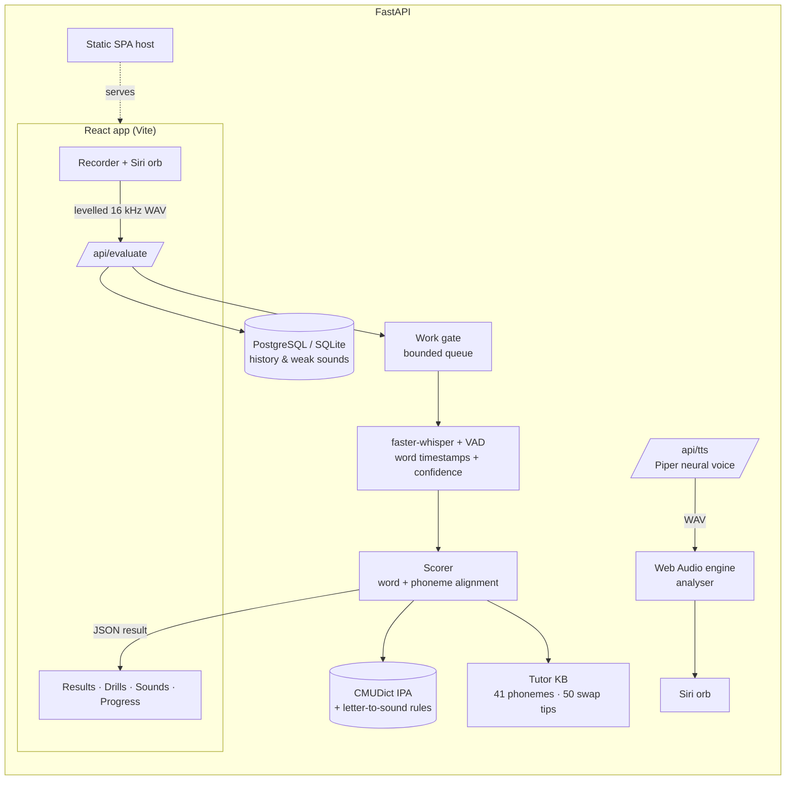

# AI Pronunciation Coach


Speak a phrase and see exactly which **sounds** slipped, not just a score. The coach transcribes your speech with Whisper, aligns it against the target sentence word by word and phoneme by phoneme, and then teaches you how to fix each mistake with mouth-placement guides, minimal pairs and targeted drills.

**Live demo:** [Hugging Face Space](https://alimehdi973-ai-pronunciation-coach.hf.space)

---

## Features

- **Practice studio**: curated phrases at three levels, or your own text. IPA appears under every word, with reference audio at normal and slow speed.
- **Siri-style voice orb**: a WebGL glass orb modelled on the new Siri. Twisting silk ribbons of light are driven by real audio: your microphone while listening, and the coach's neural voice or your recording playback while speaking. It shows a calm loading comet while it analyses.
- **Four scores per attempt**: Pronunciation, Fluency, Clarity and Completeness, shown as activity rings.
- **Word-by-word transcript**: words are coloured as correct, unclear, mispronounced, skipped or extra. Play your recording with live word highlighting, or tap a word to hear just that segment.
- **Word inspector**: a sound-by-sound comparison (target vs. what was heard), syllables with stress, and an inline tutor for the exact slip (for example */θ/ → /s/*).
- **Targeted drills**: built from your most frequent mistakes. Record each minimal pair, and the coach checks which word it heard.
- **Sound library**: all 41 American English sounds with articulation steps, examples and minimal pairs you can listen to.
- **Progress**: averages, best score, streaks, score trend, trouble sounds and session history.
- **Polish**: dark and light themes, a ⌘K command palette, keyboard shortcuts (`Space` record, `R` retry, `N` next, `L` listen), a responsive mobile layout and respect for reduced motion.

## How scoring works

1. **Transcription.** The browser levels your recording (quiet microphones are boosted up to +24 dB with a soft limiter) and sends 16 kHz WAV. Whisper (faster-whisper, int8) transcribes it with word-level timestamps and confidence, and voice-activity detection skips silence so empty clips aren't "heard" as words.
2. **Word alignment.** A weighted edit-distance alignment pairs spoken words with target words, so one skipped word doesn't shift every later word. Numbers are spelled out ("10" = "ten"), and homophones count as correct.
3. **Phoneme alignment.** Each word pair is compared as IPA phoneme tokens from **CMUDict**. Words the dictionary doesn't know (Whisper often writes mispronunciations as non-words like *"tings"*) use a rule-based letter-to-sound fallback. Near sounds (*ship/sheep*, voicing slips) get partial credit.
4. **Metrics** (each 0–100):
   - **Pronunciation**: phoneme accuracy of the words you said.
   - **Completeness**: share of target words you attempted.
   - **Fluency**: speaking rate, long pauses and filler words (from the timestamps).
   - **Clarity**: Whisper's confidence on the target words. This catches words it recognised but that sounded unclear.

   The overall score is a weighted blend, capped by completeness and curved by difficulty (Beginner is lenient, Advanced is strict).

> These are heuristics built on ASR output rather than a forced-alignment acoustic model: they measure how intelligible your speech was to Whisper, at the level of words and sounds.

## Architecture



## Tech stack

| Layer | Tools |
|---|---|
| Frontend | React 19, TypeScript, Vite, Tailwind CSS v4, shadcn/ui (Radix), Motion (Framer Motion), GSAP (SplitText, ScrollTrigger), Phosphor Icons, Recharts, TanStack Query, Zustand, cmdk, Sonner |
| Backend | Python 3.11, FastAPI, Uvicorn, SQLAlchemy, Prometheus client |
| Speech & phonetics | faster-whisper (CTranslate2, Silero VAD), NLTK CMUDict, Piper neural TTS, Epitran (optional fallback) |
| Data | PostgreSQL (e.g. Neon) in production, SQLite locally |
| Delivery | Docker (multi-stage), GitHub Actions CI |

---

## Getting started

**Prerequisites:** Python 3.11+, Node.js 20+. `ffmpeg` is used if it's on your `PATH`; otherwise the bundled `imageio-ffmpeg` binary is used automatically.

```bash
git clone https://github.com/alimehdikhan/A.I-Pronunciation-Coach.git
cd A.I-Pronunciation-Coach

# Backend
python -m venv .venv
source .venv/bin/activate            # Windows: .venv\Scripts\activate
pip install -r backend/requirements.txt -r backend/requirements-dev.txt

# Frontend
cd frontend && npm ci && cd ..
```

### Development (hot reload)

Run the API and the Vite dev server in two terminals, then open **http://localhost:5173**:

```bash
make dev-api     # or: python -m uvicorn backend.main:app --reload --port 8000
make dev-web     # or: cd frontend && npm run dev
```

Vite proxies `/api` and `/health` to the backend. The first start downloads the Whisper model (about 140 MB for `base`). The server starts accepting requests immediately and loads models in the background; speech endpoints answer `503` with `Retry-After` until they're ready. Set `PRONUNCIATION_COACH_LOAD_MODELS_ON_STARTUP=0` to work on the UI without loading them.

### Production build

```bash
make run         # builds frontend/dist, then FastAPI serves UI + API on :8000
```

FastAPI serves the built app with client-side routing, a strict Content-Security-Policy, long-lived caching for fingerprinted assets, gzip, and JSON 404s for unknown API routes.

## Deployment

### Docker

```bash
docker build -t pronunciation-coach .
docker run -p 7860:7860 -e NEON_DATABASE_URL="postgresql://…" pronunciation-coach
```

The image builds the frontend in a Node stage, installs the Python dependencies (no PyTorch: faster-whisper runs on CTranslate2), bakes in CMUDict, the Whisper weights and the coach's voice for fast cold starts, logs JSON, and runs as a non-root user. Use `--build-arg PRELOAD_WHISPER=` to skip baking the model, or set `WHISPER_MODEL_SIZE` to change it. Without `NEON_DATABASE_URL`, history is stored in SQLite inside the container and is lost when it's replaced.

### Hugging Face Spaces

The front matter at the top of this README configures a Docker Space on port 7860. Push to your Space remote and add `NEON_DATABASE_URL` as a secret to keep history across restarts.

### Render

`render.yaml` builds with `build.sh` (Python dependencies plus the frontend build) and starts Uvicorn. Set `NEON_DATABASE_URL` in the dashboard.

## Configuration

All settings are environment variables. See [`.env.example`](.env.example).

| Variable | Default | Description |
|---|---|---|
| `NEON_DATABASE_URL` | `sqlite:///./pronunciation_coach.db` | PostgreSQL URL (e.g. Neon) or SQLite path |
| `WHISPER_MODEL_SIZE` | `base` | `tiny`, `base`, `small`, `medium`, `large` |
| `PRONUNCIATION_LANGUAGE` | `eng-Latn` | Epitran code for the out-of-dictionary fallback |
| `PRONUNCIATION_COACH_LOAD_MODELS_ON_STARTUP` | `1` | `0` skips loading Whisper (UI work, tests) |
| `PRONUNCIATION_COACH_MAX_UPLOAD_BYTES` | `26214400` | Max upload size (25 MB) |
| `PRONUNCIATION_COACH_RATE_LIMIT` | `30` | Audio requests per client IP per minute (`0` disables) |
| `PRONUNCIATION_COACH_TTS` | `1` | Neural coach voice at `/api/tts` (`0` falls back to browser speech, without orb sync) |
| `PRONUNCIATION_COACH_TTS_VOICE` | `en_US-lessac-medium` | Piper voice, downloaded on first start if not cached |
| `PRONUNCIATION_COACH_TTS_DIR` | `~/.cache/pronunciation_coach/piper` | Voice model cache directory |
| `PRONUNCIATION_COACH_ASR_DEVICE` | `auto` | `cpu`, `cuda` or `auto` |
| `PRONUNCIATION_COACH_ASR_COMPUTE_TYPE` | `auto` | CTranslate2 precision (`int8` on CPU, `float16` on GPU by default) |
| `PRONUNCIATION_COACH_ASR_BEAM_SIZE` | `5` | Whisper beam size (`1` is slightly faster) |
| `PRONUNCIATION_COACH_ASR_THREADS` | `0` | CPU threads per transcription (`0` = all cores) |
| `PRONUNCIATION_COACH_ASR_CONCURRENCY` | `1` | Transcriptions run at once |
| `PRONUNCIATION_COACH_ASR_QUEUE_LIMIT` | `8` | Transcriptions allowed to wait; beyond that requests get `503` + `Retry-After` |
| `PRONUNCIATION_COACH_ASR_DIR` | `~/.cache/pronunciation_coach/whisper` | Whisper model cache directory |
| `PRONUNCIATION_COACH_MAX_AUDIO_SECONDS` | `60` | Longest accepted recording |
| `PRONUNCIATION_COACH_CORS_ORIGINS` | localhost | Comma-separated allowed origins |
| `PRONUNCIATION_COACH_FRONTEND_DIR` | `frontend/dist` | Location of the built UI |
| `PRONUNCIATION_COACH_FRAME_ANCESTORS` | `'self' https://huggingface.co https://*.hf.space` | Pages allowed to embed the app (CSP `frame-ancestors`) |
| `PRONUNCIATION_COACH_METRICS` | `1` | Expose Prometheus metrics at `/metrics` |
| `PRONUNCIATION_COACH_METRICS_TOKEN` | unset | If set, `/metrics` requires `Authorization: Bearer <token>` |
| `PRONUNCIATION_COACH_LOG_LEVEL` | `INFO` | Log level |
| `PRONUNCIATION_COACH_LOG_FORMAT` | `text` | `json` for structured logs (the Docker image uses `json`) |
| `VITE_API_URL` | same origin | Build-time API origin if the UI is hosted separately |

## API

| Method | Path | Description |
|---|---|---|
| `GET` | `/health` | Liveness, model status and phoneme backend |
| `GET` | `/ready` | `200` only when models are loaded and the database is reachable |
| `GET` | `/metrics` | Prometheus metrics (request latency by route, Whisper queue, TTS cache, rate limiting) |
| `POST` | `/api/evaluate` | Score a recording (`audio`, `target_text`, optional `difficulty`, `username`) |
| `POST` | `/api/transcribe` | Transcribe with word timings, no scoring |
| `GET` | `/api/tts?text=&rate=` | The coach's neural voice as WAV (cached), played through Web Audio so the orb follows it |
| `GET` | `/api/pronounce?text=` | IPA, syllables and stress for each word of a sentence |
| `GET` | `/api/phonemes` | All 41 phonemes (summary) |
| `GET` | `/api/phonemes/{symbol}` | Full tutor entry for one phoneme |
| `GET` | `/api/tutor/card?word=&expected=&actual=` | Tutor card for a specific slip |
| `GET` | `/api/tutor/personalized-practice/{username}` | Drills for a user's weakest sounds |
| `GET` | `/api/history/{username}` | Recent attempts with phoneme mistakes |
| `DELETE` | `/api/history/{username}` | Delete a user's history (requires the profile key) |
| `GET` | `/api/analytics/{username}` | Averages, streaks, trend and top weaknesses |

Interactive docs are available at `/docs`.

**Profiles.** There are no accounts. Each browser keeps a random profile key and sends it as `X-Profile-Key`; the first browser to use a name claims it, and only that key can read, add to or delete its history afterwards (the server stores only a SHA-256 hash). Names created before this existed stay readable until their owner's browser claims them. If a name is claimed elsewhere, evaluation still returns feedback with `"saved": false, "save_error": "profile_locked"`, and the history endpoints return `403` with `"code": "profile_locked"`. To release a name (for example after clearing browser data), run `python -m backend.manage unlock "<name>"`; `python -m backend.manage users` lists names and their claim status.

Every response carries an `X-Request-ID` (also in the logs), and `/api/evaluate` reports `Server-Timing` for its upload, decode, asr, score and save stages.

```bash
./scripts/test_evaluate.sh my-recording.wav "Today is a beautiful day."
```

## Testing

```bash
make test        # pytest (models mocked, real scorer and phonetics)
make lint        # ruff
make typecheck   # TypeScript
```

CI runs the backend lint and tests plus the frontend typecheck and production build on every push and pull request.

## Project structure

```
backend/
  main.py           App assembly: middleware, routers, startup, SPA mount
  config.py         Settings from the environment
  api/              Routes: health, speech (evaluate/transcribe/tts), library, progress
  runtime.py        Loaded models and the bounded transcription queue
  audio.py          Upload validation, WAV fast path, hardened ffmpeg, loudness normalisation
  asr.py            faster-whisper wrapper (VAD, word timestamps)
  tts.py            Piper neural voice with an LRU cache
  repositories.py   Database queries (SQL aggregates for analytics)
  security.py       Rate limiting, profile keys, security headers, body size limit
  observability.py  Logging, request IDs, Prometheus metrics, Server-Timing
  spa.py            React app hosting with CSP
  pronunciation.py  Scoring: alignment, metrics, insights
  phonetics.py      Tokenising, CMUDict→IPA, letter-to-sound rules, syllables, alignment
  phoneme_kb.py     Tutor knowledge base (41 phonemes, substitution and deletion tips)
  tutor.py          Tutor cards and personalised drills
  database.py       SQLAlchemy models, indexes, additive migrations, schemas
frontend/src/
  pages/            Practice, Drills, Sounds, Progress
  components/       practice/ (orb, results, inspector), tutor/, layout/, ui/ (shadcn)
  hooks/            Recorder, playback, audio peaks, hotkeys
  lib/              API client, queries, speech synthesis, GSAP helpers
tests/              API, security, audio, analytics/migration, scorer, phonetics and tutor tests
```

## License

MIT
