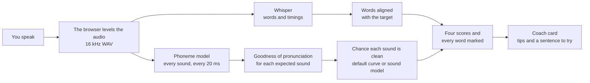
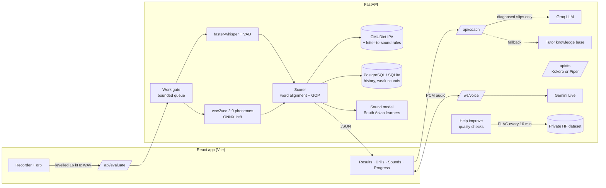

<p align="center">
  <picture>
    <source media="(prefers-color-scheme: dark)" srcset="assets/logo-dark.png">
    
  </picture>
</p>

<p align="center"><b>Speak English that people understand.</b></p>

<p align="center">Say a sentence. Vocaly AI marks each sound that came out wrong (a th heard as f, a v heard as w)<br>and shows you how to fix it.</p>

<p align="center">
  <a href="https://alimehdi973-ai-pronunciation-coach.hf.space"></a>
  <a href="#license"></a>
</p>

<table align="center">
  <tr>
    <td align="right"><b>Frontend</b></td>
    <td>
      <a href="https://react.dev"></a>
      <a href="https://www.typescriptlang.org"></a>
      <a href="https://vite.dev"></a>
      <a href="https://tailwindcss.com"></a>
      <a href="https://ui.shadcn.com"></a>
      <a href="https://www.radix-ui.com"></a>
      <a href="https://motion.dev"></a>
      <a href="https://gsap.com"></a>
      <a href="https://threejs.org"></a>
      <a href="https://tanstack.com/query"></a>
      <a href="https://reactrouter.com"></a>
      <a href="https://zustand.docs.pmnd.rs"></a>
      <a href="https://recharts.org"></a>
      <a href="https://phosphoricons.com"></a>
    </td>
  </tr>
  <tr>
    <td align="right"><b>Backend</b></td>
    <td>
      <a href="https://www.python.org"></a>
      <a href="https://fastapi.tiangolo.com"></a>
      <a href="https://www.uvicorn.org"></a>
      <a href="https://docs.pydantic.dev"></a>
      <a href="https://www.sqlalchemy.org"></a>
      <a href="https://sqlite.org"></a>
      <a href="https://www.postgresql.org"></a>
      <a href="https://prometheus.io"></a>
    </td>
  </tr>
  <tr>
    <td align="right"><b>Speech&nbsp;&amp;&nbsp;AI</b></td>
    <td>
      <a href="https://github.com/SYSTRAN/faster-whisper"></a>
      <a href="https://huggingface.co/facebook/wav2vec2-lv-60-espeak-cv-ft"></a>
      <a href="https://onnxruntime.ai"></a>
      <a href="https://huggingface.co/hexgrad/Kokoro-82M"></a>
      <a href="https://github.com/OHF-Voice/piper1-gpl"></a>
      <a href="https://ai.google.dev/gemini-api/docs/live"></a>
      <a href="https://groq.com"></a>
      <a href="https://scikit-learn.org"></a>
      <a href="https://numpy.org"></a>
      <a href="https://www.nltk.org"></a>
      <a href="https://ffmpeg.org"></a>
    </td>
  </tr>
  <tr>
    <td align="right"><b>Ship&nbsp;&amp;&nbsp;test</b></td>
    <td>
      <a href="https://huggingface.co/spaces"></a>
      <a href="https://huggingface.co/docs/hub/datasets"></a>
      <a href="https://www.docker.com"></a>
      <a href="https://render.com"></a>
      <a href="https://nodejs.org"></a>
      <a href="https://github.com/features/actions"></a>
      <a href="https://pytest.org"></a>
      <a href="https://docs.astral.sh/ruff"></a>
    </td>
  </tr>
</table>

<p align="center">
  <a href="https://alimehdi973-ai-pronunciation-coach.hf.space"><b>Live demo</b></a> ·
  <a href="#features">Features</a> ·
  <a href="#how-it-works">How it works</a> ·
  <a href="#run-it-locally">Run locally</a> ·
  <a href="#api">API</a>
</p>

<p align="center">
  
</p>

## Contents

- [Features](#features)
- [Screenshots](#screenshots)
- [How it works](#how-it-works)
- [How accurate it is](#how-accurate-it-is)
- [Features in depth](#features-in-depth)
- [Help improve Vocaly AI](#help-improve-vocaly-ai)
- [Architecture](#architecture)
- [Run it locally](#run-it-locally) · [Deployment](#deployment) · [Configuration](#configuration) · [API](#api)
- [Tests](#tests) · [Project layout](#project-layout) · [License](#license)

## Features

### Practice

Pick a sentence at one of three levels or type your own. Every word is respelled in plain letters (uh-BOWT) or IPA, and a neural voice reads it at normal or slow speed.

After you speak you get four scores: pronunciation, fluency, clarity and completeness. Each word is marked correct, unclear, mispronounced, skipped or extra, and tapping one shows it sound by sound and replays just that part of your recording. A likely slip is marked *Fix this*. A borderline one is *Worth checking*, which you can settle by saying the word on its own.

The target is American or British English. Speakers of Hindi, Urdu, Bengali, Gujarati, Marathi, Punjabi, Tamil and Telugu are scored by a sound model trained for them ([how it was trained](#speakers-of-south-asian-languages)).

### Coaching

Each attempt ends with a coach card: a line or two on how it went, one tip per slip and a sentence to try next. The Coach page goes further. It looks through your history for the sound you miss most and runs a five-step session on it. You can also type questions to the coach or talk to it out loud, and tips come in English, Hindi, Urdu or Hinglish.

### Interviews

A spoken interviewer runs eight kinds of mock interview, from an HR round to a student visa interview. By default it is hands-free: the microphone opens after each question, closes when you stop talking, and the next question plays straight away. Upload a CV and a job advert and the questions are written for that job. There is also a group discussion with three AI participants and a moderator, and a *Speak freely* mode for interview questions, IELTS-style cue cards and everyday situations.

### Drills and listening

| Mode | What it does |
|---|---|
| Minimal pairs | Built from the sounds you get wrong most often |
| Listening drills | Many different voices, so you learn to hear a contrast before you say it |
| Real listeners | Other learners play your recording and type what they heard |
| Sound library | All 41 American English sounds, with how to make each one |

### Progress

The Progress page keeps streaks, score trends and your history. The Journey page adds levels, badges and a daily goal. *Before & after* plays your first recordings next to your latest ones, and *Day 1 vs Day 30* turns two answers to the same interview question into a short video. A teacher can hear one of your attempts through a share link, which stops working after seven days.

### Privacy

Audio is kept only when you agree to it, and only for the features that need it. *Help improve Vocaly AI* stays off until you switch it on, and its Delete button removes everything you gave. Your history, recordings, interviews and account can all be deleted from Profile → Your data.

<details>
<summary><b>The practice page in detail</b></summary>

The practice page offers sentences at three levels, or your own text. Every word shows how it sounds, in plain letters (uh-BOWT) or IPA (your choice in Settings), and you can hear the sentence at normal or slow speed in a neural voice. The orb in the middle is a WebGL shader that follows the real audio: your microphone while you record, the coach's voice or your own playback otherwise.

After you speak, you get four scores (pronunciation, fluency, clarity, completeness) and a transcript where each word is marked correct, unclear, mispronounced, skipped or extra. A mispronounced word is either *Fix this* (a likely real slip) or *Worth checking* (borderline, not counted against you). Tap a word to see it sound by sound, with the chance each sound would be rated clean, and to hear just that segment of your recording. A word shows as *unclear* when the sounds look fine but Whisper heard a different word, and the card says what it heard. Under the transcript, a coach card gives a short summary, one tip per slip and a sentence to try next.

Four more pages: drills built from the sounds you miss most often (you record each minimal pair and the coach checks which word it heard), a library of all 41 American English sounds with articulation steps and minimal pairs, a progress page with streaks, trends and history, and a profile page where you manage your account.

Keyboard: `Space` records, `R` retries, `N` moves to the next phrase, `L` plays the sentence, `C` says a *Worth checking* word on its own (while it is open in the word inspector), `M` opens the microphone check, `Ctrl/⌘ K` opens the command palette. Dark and light themes, a layout for phones, and reduced-motion support.

</details>

## Screenshots

<table>
  <tr>
    <td width="50%" valign="top"><br><sub><b>Results.</b> The score, whether a listener would understand you, and every word marked.</sub></td>
    <td width="50%" valign="top"><br><sub><b>Word inspector.</b> “third” sound by sound, with /θ/ heard as /f/.</sub></td>
  </tr>
  <tr>
    <td width="50%" valign="top"><br><sub><b>Coach card.</b> A short summary, the word to check and a sentence to try next.</sub></td>
    <td width="50%" valign="top"><br><sub><b>Coach page.</b> Today’s focus sound and your clean rate for every sound.</sub></td>
  </tr>
  <tr>
    <td width="50%" valign="top"><br><sub><b>Journey.</b> Your level, today’s goal and the path through all 41 sounds.</sub></td>
    <td width="50%" valign="top"><br><sub><b>Drills.</b> The minimal-pair challenge for th, next to the guide for the sound.</sub></td>
  </tr>
  <tr>
    <td width="50%" valign="top"><br><sub><b>Sound Library.</b> How to make th as in “think”, with words that sound alike.</sub></td>
    <td width="50%" valign="top"><br><sub><b>Progress.</b> Your usual score, what to practise next and your scores over time.</sub></td>
  </tr>
  <tr>
    <td width="50%" valign="top"><br><sub><b>Coach chat.</b> “How do I say thorough?” answered with the stress and the th sound.</sub></td>
    <td width="50%" valign="top"><br><sub><b>Talk to your coach.</b> A live spoken conversation, with the coach’s reply under the orb.</sub></td>
  </tr>
</table>

The screenshots are from the running app in Chrome (1600 × 900, dark theme), taken in October 2026. The learner is a synthetic voice (Kokoro) saying "I think this is the furd time" against the target "I think this is the third time", so the slip is deliberate; every score, flag and tip is what the app returned for that recording.

## How it works

The app transcribes your speech with Whisper, listens for the individual sounds with a phoneme recogniser, compares both against the target sentence, and explains each slip.



1. **The browser levels the audio.** Quiet microphones are boosted by up to 24 dB with a soft limiter, then the clip is encoded as 16 kHz mono WAV, so the server rarely needs ffmpeg.
2. **Whisper transcribes it** (faster-whisper, int8) with word timestamps and confidence. Voice activity detection drops silence, which stops Whisper from inventing words on empty clips.
3. **A phoneme model hears the sounds.** wav2vec 2.0 fine-tuned for espeak IPA runs on ONNX Runtime and returns a probability for every sound in every 20 ms frame. It has no language model, so it does not "correct" a wrong sound into the right word the way Whisper tends to.
4. **Goodness of pronunciation per sound.** For each expected sound the scorer computes how likely it is, given everything else in the sentence, against every alternative, including "dropped". The strongest alternative becomes the diagnosis (`/θ/ came out as /s/`). The method is the alignment-free GOP of Cao et al. (Interspeech 2024).
5. **Words are aligned** with a weighted edit distance, so one skipped word does not shift the rest. Numbers are spelled out and homophones count as correct. Each word's score blends what Whisper heard with what the audio sounded like.
6. **The four metrics** are pronunciation (sound accuracy of the words you said), completeness (share of target words you attempted), fluency (speaking rate, long pauses, extra words) and clarity (Whisper's confidence on the target words). The overall score is a weighted blend, capped by completeness and curved by difficulty.

When the phoneme model is not installed, steps 3 and 4 are skipped and scoring uses Whisper's words and CMUDict alone. Everything still works, with less precise sound-level feedback.

<details>
<summary><b>The coaching session</b></summary>

The Coach page (`/coach`, sign-in required) works from what the app has recorded about you. Every sound you attempt is stored as clean or not, so the coach knows your clean-rate per sound and whether it is improving, steady or slipping.

It then picks one sound to work on, weighting how often it goes wrong by how often you try it and giving slipping sounds a boost, and says why in numbers ("you said /θ/ cleanly 3 of 10 times, and it has slipped lately"). The session has five steps: feel the sound (mouth placement), hear minimal pairs, say words (your own most-missed words first), say a sentence, and a review that compares today with your history. Each recording is checked for that one sound only.

After any normal attempt the coach card ends with a single "change this on your next try" cue instead of a list. The focus and every number come from your history; the language model only writes the wording, and a built-in coach does when it is unavailable.

</details>

## How accurate it is

Scoring was checked against expert ratings on [speechocean762](https://huggingface.co/datasets/mispeech/speechocean762) (Apache-2.0): 5,000 English sentences read by Mandarin speakers, rated per sentence, word and sound by trained annotators. The blend weights, sound threshold and fluency curve were fitted on its training split. The figures below are on recordings from the test split that were not used for fitting. Correlations are Pearson's r with the human rating.

| Test split, 500 recordings | Before | Now |
|---|---:|---:|
| Sentence accuracy | 0.514 | **0.651** |
| Sentence overall score | 0.507 | **0.697** |
| Sentence fluency | −0.084 | **0.627** |
| Word accuracy | 0.422 | **0.555** |
| Sound agreement (per sound) | n/a | 0.536 |
| "Was this sound wrong?" (AUC) | n/a | 0.939 |

"Before" is the app as it was: Whisper's words and CMUDict only, with a fluency score that penalised fast speech. On a second set of 300 recordings the same code scores 0.717 sentence accuracy, 0.626 word accuracy and 0.744 fluency; the blend weights were fitted on that second set, so treat those as optimistic.

The fluency rule changed because human raters in this data score *faster* readers as more fluent (word rate correlates at +0.56 with their fluency rating), while the old rule punished anything over 180 words per minute. The audio model also rescues words Whisper drops: when Whisper reports a word as missing but the sounds are there, the word is scored from the sounds instead of getting zero. That one change moved word accuracy from 0.398 to 0.555.

The scores estimate how a human rater would hear you. They are not a measurement of your accent, and the absolute level is generous: a sentence with one wrong sound in seven words can still score in the nineties.

### What these numbers do not say

The recordings are scripted reading by one first-language group, so they say little about spontaneous speech or other accents. Only about 4% of sounds in the data are rated less than clean, which makes "was this sound wrong" a rare-event problem. At the threshold the app uses, about two flagged sounds in five are real slips (0.41 precision on the test split), and many slips go unflagged.

The phoneme model also leans toward the sound you were supposed to make. In a separate check I had the Piper voice say twelve deliberate substitutions inside full sentences (θ→s, ð→d, v→b, r→l, ʃ→s and similar). The sound model flagged four of them, and Whisper hearing a different word caught two more, so half were reported as less than clean. When the same sounds are spoken alone the model separates them (it hears `think` and `sink` differently), but inside a familiar phrase it often hears the intended sound: `berry` read as `very` came back clean both times. Synthetic speech is not learner speech, so this is not a recall figure for real users, but it is the main weakness to know about. A model fine-tuned on non-native speech would be the next step.

### Speakers of South Asian languages

The numbers above are for Mandarin speakers, and the curve that turns each sound's evidence into "chance it is clean" was fitted on them. For Indian speakers it misses almost everything. On [L2-ARCTIC](https://psi.engr.tamu.edu/l2-arctic-corpus/) (24 speakers of six first languages reading English, every sound marked by trained annotators as right, distorted, replaced or dropped; CC BY-NC 4.0, used through the 16 kHz mirror `chikingsley/l2-arctic-manual-v5.0-16k`), the default curve flagged under 1% of a Hindi speaker's sounds and caught 4% of the ones the annotators marked wrong.

So learners whose first language is Hindi, Urdu, Bengali, Gujarati, Marathi, Punjabi, Tamil or Telugu are scored by a trained **sound model** instead (`backend/sound_model.py`, `backend/data/sound_models/south_asian.json`). Besides the evidence for the sound itself, it looks at how long the sound lasted, the strongest competing sound and whether the sound was dropped, how clean the neighbouring sounds and the whole recording were, and which sound it is. `scripts/train_sound_model.py` compared the curve refitted, logistic regression and gradient-boosted trees, each with three sets of features (all; without which sound it is; without any sound identity), on two training sets (L2-ARCTIC's training speakers, with and without speechocean762), and calibrated each on the validation speakers.

**False alarms on correct speech come first.** A first version chose its cut-offs only to catch the most slips. It caught half of them, but it also flagged 10% of the sounds in correct native speech, and it flagged /ð/ in "this" said by a native voice: it had learned that this group often gets /ð/ wrong and judged the sound by its name. So every candidate is now also run on a **native check set**: all 82 practice sentences read by four native voices (Kokoro: two American, two British, scored against their own accent). Each candidate's cut-offs are the ones that catch the most slips on the validation speakers (F1) while flagging at most 2% of the sounds in two of those voices, and at most 10% of any one sound; "Fix this" at most 0.5%. Nothing is chosen by sound identity alone: a model that can't stay under those limits at any cut-off is dropped. The candidate that caught the most at its cut-off was **logistic regression on all features, trained on L2-ARCTIC (Hindi speakers weighted three times) and speechocean762**. Its cut-offs are mapped onto 0.80 and 0.70, so the tiers mean the same for everyone. Confident-learning label cleaning was tried in the first version and didn't help, so it is off.

On speakers held out from all of that (L2-ARCTIC's fixed test speakers; the Hindi one is TNI) and the two native voices the cut-offs never saw:

| Held out | | "Was this sound wrong?" (AUC) | Agreement (r) | Flags that are real | Real slips flagged | *Fix this* that are real | Real slips in *Fix this* |
|---|---|---:|---:|---:|---:|---:|---:|
| Hindi speaker (4,897 sounds) | default curve | 0.602 | 0.143 | 0.39 | 0.04 | 0.44 | 0.03 |
| | **sound model** | **0.776** | **0.329** | **0.45** | **0.13** | **0.64** | **0.04** |
| All six test speakers | default curve | 0.695 | 0.253 | 0.61 | 0.07 | 0.68 | 0.04 |
| | **sound model** | **0.836** | **0.416** | 0.59 | **0.18** | **0.74** | **0.07** |

| Correct native speech (2 unseen voices) | Sounds flagged | *Fix this* | Most-flagged sound |
|---|---:|---:|---|
| default curve | 0.1% | 0.0% | /ɔ/, 2% of the time |
| sound model | 1.0% | 0.0% | /ɝ/, 12% of the time |

For the Hindi speaker it catches three times as many of the slips the annotators heard, and its flags are right more often (0.45 against 0.39; *Fix this* 0.64 against 0.44). Scored the way the app scores (dictionary pronunciations, Whisper not involved), it flags 2.4% of that speaker's sounds instead of 0.9%, and the average sentence score goes from 98.8 to 93.6. The slips it reports most are the ones the annotators heard most: a dropped /r/, /z/ said as /s/, /ð/ as /d/ ("the" as "de") and /θ/ as /t/. It adds no noticeable time: the model is 16 KB of weights the app runs with numpy.

Limits: it still misses most slips. The annotators marked about 10% of this speaker's sounds wrong, and the model flags a quarter as many sounds, because flagging more would mean flagging correct speech too. Four Hindi speakers are in the data (two for training, one for validation, one for testing), all reading scripted sentences, and there are no Urdu, Bengali, Tamil or Telugu speakers, so the numbers say how it does on careful reading by speakers like them, not on everyone the profile covers. The native check set is synthetic speech, which is cleaner than any real voice. L2-ARCTIC's annotators judged against General American English and mark Indian-English features (dental t and d for th, v and w, a dropped r) as wrong, so the model is closer to *Reduce my accent* than to *Be clearly understood*; the goal setting still decides which slips get tips. On speechocean762's Mandarin speakers it does worse than the default curve (AUC 0.857 against 0.924), which is why it is used only for the languages above. L2-ARCTIC is licensed for non-commercial use only: a paid copy of the app should retrain this model on its own reviewed recordings (see [Help improve Vocaly AI](#help-improve-vocaly-ai)) before charging. The sound model judges practice, drills, the coach session, the check-up and interview answers. *Say just this word* and the before-and-after recordings keep the default curve, so their cut-offs and comparisons over time stay as they were, and so do Speak freely and group discussions, which don't send who is speaking.

<details>
<summary><b>British English target</b></summary>

Settings → *Your coach* offers **American English** (the default) or **British English**. With British:

- **Non-rhotic speech is accepted.** Every word also gets its r-less form: no /r/ unless a vowel follows ("car" /kɑ/, "better" /bɛtə/, while "red" and "very" keep theirs). These are extra accepted variants, like the weak forms, so the American target is untouched.
- **British IPA and plain letters**, approximating RP: /gəʊ/, /bɜːd/, /ˈbɛtə/, "kah" for "car" (`/api/pronounce?accent=british`).
- **The British voice.** "Hear it" and the sentence playback use `bf_emma`, unless you picked a voice yourself.

| Test split, 500 recordings | American target | British target |
|---|---:|---:|
| Sentence accuracy | 0.651 | 0.659 |
| Sentence overall score | 0.697 | 0.700 |
| Word accuracy | 0.556 | 0.559 |
| "Was this sound wrong?" (AUC) | 0.939 | 0.939 |

(`scripts/eval_speechocean.py report --accent british`.) The American numbers are unchanged. The British target agrees slightly better with these raters, probably because many of these speakers drop post-vowel r and the raters did not count that as an error.

Not done yet: a real en-GB pronunciation lexicon. The BATH and TRAP split ("dance" as /dɑːns/), the LOT vowel /ɒ/ and British word-specific forms ("schedule", "tomato") are not modelled, so the target sound for those words is still American. Single-word checks, Speak freely and before-and-after scoring use the American target.

</details>

<details>
<summary><b>Word stress (experimental, off by default)</b></summary>

Settings → *Word stress (experimental)* turns on a check of which syllable of each long word you stressed (`stress=true` on `/api/evaluate`). The sound alignment already times every vowel; for each word of two or more syllables the check compares the syllables' vowels on length, loudness and pitch (autocorrelation), each as a z-score within the word so a quiet or low voice is not penalised. The most prominent syllable is shown in the word inspector as "you stressed". A stress slip is reported only when it beats the dictionary's stressed syllable by a clear margin (2.5 summed z-scores; on a two-syllable word that means length, loudness and pitch all point the wrong way).

It does not agree well with expert listeners, which is why it is experimental. speechocean762 rates each word's stress, and `scripts/eval_stress.py` compared the check with those ratings on words whose sounds were aligned exactly:

| | Training split | Test split |
|---|---:|---:|
| Words of two or more syllables | 1,514 | 309 |
| Rated as wrong stress by the experts | 48 (3.2%) | 14 (4.5%) |
| "Stressed another syllable" agrees with the experts' right/wrong | 65% | 73% |
| Flagged at the chosen margin (2.5) | 7, of which 2 real (29% precision, 4% recall) | 0 |

At lower margins about 6% of flags are real, barely above the base rate. So the check rarely reports anything, and the "you stressed" marker should be read as a hint. Likely reasons: the speakers in the data read carefully and rarely misplace stress, the vowel timings come from a phoneme model rather than a forced aligner, and English stress also shows in vowel quality (reduced /ə/), which this does not measure.

</details>

<details>
<summary><b>Natural speed</b></summary>

Reading slowly and over-pronouncing every sound gets high scores, but it is not how anyone talks. An attempt slower than **100 words a minute** is labelled *careful speech* next to its pace. With **Natural speed** on (Settings), careful attempts are still scored, shown and saved, but they don't count toward your sound mastery, the coach's choice of focus, your streak or your daily goal. History marks them "not counted".

Why 100: on speechocean762's training split (300 recordings, Whisper's word timings), 95% of the readers the experts rated fluent (8 or more out of 10) read faster than 103 words a minute, and the median reader 150. Recordings under 100 wpm (15% of them) had a mean fluency rating of 5.7, against 8.1 for the rest. The cut-off is `PRONUNCIATION_COACH_CAREFUL_WPM`.

Limits: the readers in that data are reading, not talking, and slow reading there is mostly struggling rather than deliberate over-enunciation, so the cut-off says "slower than fluent readers", not "fake". Pace is measured from the first to the last word Whisper heard, so a long pause in the middle slows it. Very short phrases (under three words) are never labelled.

</details>

<details>
<summary><b>Would a listener understand you?</b></summary>

Next to the scores, the results show a **machine estimate** of whether a listener would catch your words: the share of target words that Whisper recovered (after the usual normalisation, so numbers spelled out and homophones count). Whisper is given no prompt or hint about the target sentence, so it hears you cold, the way a stranger would. The existing transcript is reused: there is no second pass and no extra wait. In the transcript a wavy underline marks the words a listener would likely miss, separately from the colours for sound slips, and the word inspector says what came across instead.

It is not folded into the overall score. On the 500 test recordings it averages 74% and correlates at r = 0.48 with the experts' overall rating (0.49 with their accuracy rating), clearly weaker than the score itself (0.70), so it is labelled an estimate. Limits: Whisper is not a person. It misses some words a person would get (it writes "third" as "3rd", which then counts as missed), and it gets some a person would not, because its language model guesses likely words. It has not been checked against real listeners. Speechocean762 has no listener ratings to check it against.

</details>

<details>
<summary><b>“Fix this” and “Worth checking”</b></summary>

Because so many flags are false alarms, flagged sounds come in two tiers. A sound whose chance of being rated clean is below 0.70 is **Fix this** (solid red in the transcript). One between 0.70 and the flag cut-off of 0.80 is **Worth checking** (amber, dashed outline). The cut-off was chosen on the training split alone (2,500 recordings, 1,278 real slips) as the loosest one at which "Fix this" reached 0.6 precision there (0.63). On the held-out test split:

| Test split, 500 recordings (196 real slips) | Sounds | Real slips among them (precision) | Share of all real slips (recall) |
|---|---:|---:|---:|
| All flagged sounds | 196 | 0.41 | 0.41 |
| Fix this | 83 | 0.55 | 0.23 |
| Worth checking | 113 | 0.31 | 0.18 |

A real slip is a sound the experts rated below 0.5 of 2. What each tier is allowed to do:

- **Scores don't change.** The tiers only label slips: every score, word status and metric is the same as before (the evaluation table above is unchanged).
- **Only "Fix this" counts.** It is saved as a mistake, lowers the sound's clean rate, appears in your weakest sounds and gets a coaching tip. A "Worth checking" sound is stored with its tier but counted as clean, and the coach card lists its word under *Worth checking* instead of giving a tip. When an attempt has only borderline slips, the card says it looked mostly clean; it never calls the attempt perfect, whatever the language model writes.
- **Without the phoneme model** every slip is "Fix this": the only evidence then is Whisper hearing another word, which is what a listener would hear too.

Limits: "Fix this" is still wrong almost half the time on the test split, and the tiers split only what is flagged, so the 59% of real slips the app misses stay missed. The two tiers separate less than you might hope, because the probability that sets them clusters between 0.55 and 0.80. With little history the coach now picks a sound that has already slipped ("early days") instead of saying your sounds are in good shape. To redo the calibration: `python scripts/eval_speechocean.py prepare --split train --limit 2500 --no-asr`, then `tiers --split train --limit 2500`, then `tiers --split test --fix-below 0.7`.

</details>

<details>
<summary><b>“Not sure? Say just this word”</b></summary>

A *Worth checking* word has a **Not sure? Say just this word** button, in the word inspector (`C` on the keyboard) and in the coach card. You record the word on its own and it goes through the same pipeline as a sentence (`POST /api/evaluate/confirm`, with the word as the target), with one of three outcomes:

- **Confirmed: worth fixing.** The sound slipped again. In your saved attempt that sound now counts as a miss and a mistake, so it shows in your weakest sounds, and the inspector shows the guide for fixing it.
- **Sounded fine.** The attempt's record of that sound is marked fine.
- **Couldn't hear it.** Nothing changes; try again.

Checking a word is not a new attempt: it adds nothing to streaks, daily goals or history. The original sound's saved tier changes from `check` to `slip` or `fine`, so later recalibration can see which borderline flags were real. Without the phoneme model there are no *Worth checking* slips, so the button never appears.

Said alone, the sound model separates sounds but stays generous: a correct word scores a median 98% and a substituted one 90%, so the sentence cut-off (80%) would pass almost every slip. A sound is a confirmed slip when it scores below **88%**, or below **97%** when Whisper also heard a word that differs at that very sound ("sink" for "think", but not "3rd" for "third"). The cut-offs were chosen with `scripts/eval_confirm.py`. Two Kokoro voices said every minimal pair in the sound library (119 pairs, both words, 476 recordings), each scored against the first word of its pair:

| Rule | Substitutions caught | Correct words flagged |
|---|---:|---:|
| Sound below 80% (the sentence cut-off) | 13% | 0% |
| Sound below 94% | 74% | 11% |
| **Sound below 88%, or Whisper differs and below 97% (used)** | **91%** (89% and 92% per voice) | **9%** (10% and 8%) |
| Sound below 80%, or Whisper differs at all | 96% | 18% |

Whisper on its own is too eager with single words: it turns a lone "sheet" into "See you next time." Limits: this is synthetic speech, and the same recordings were used to choose the cut-offs and to measure them (the per-voice figures agree, which is some reassurance). About one correct word in eleven is still confirmed as a slip, and there is no data yet on learners' own voices; the disputes below are meant to collect it.

</details>

<details>
<summary><b>“I think this is wrong”</b></summary>

Under every flagged sound in the word inspector, a signed-in learner can say the coach got it wrong, with an optional reason: *I said it correctly* or *That's normal in my accent* (`POST /api/disputes`). A report stores the attempt id, the word, the expected sound, what the scorer heard instead, the raw GOP value, the tier and the score saved with the attempt (the server takes those two from the database, not from the browser), and the reason. It never stores audio, and reporting the same sound again only updates the reason. Reports don't change any score. They are for recalibration:

```bash
python -m backend.manage disputes --out disputes.csv   # one row per report, with the sentence; no names
```

Reports are rate-limited, need the profile key of the attempt's owner, and are deleted with the learner's history or account. Limits: a report is the learner's opinion, not a rating by a trained listener, and "that's normal in my accent" mixes real accent features with misheard slips, so treat the export as a list of places to listen again, not as labels to train on.

</details>

<details>
<summary><b>Weak forms of small words</b></summary>

CMUDict lists careful citation forms, so a natural "fish *ən* chips" or "see *jə* later" used to be marked wrong. The twenty most common function words (a, an, the, to, for, of, and, can, was, were, have, has, them, from, you, your, at, as, but, that) now also accept their reduced vowel form (/ən/, /jə/, /ət/, /bət/, /həv/ ...). Most were already in CMUDict; `phonetics.WEAK_FORMS` adds the missing nine, and the scorer uses whichever form best matches the audio. The inspector then shows the form you actually used.

| Test split, 500 recordings | Before | With weak forms |
|---|---:|---:|
| Sentence accuracy | 0.651 | 0.651 |
| Sentence overall score | 0.697 | 0.697 |
| Sentence fluency | 0.627 | 0.628 |
| Word accuracy | 0.555 | 0.556 |
| Sound agreement (per sound) | 0.536 | 0.534 |
| "Was this sound wrong?" (AUC) | 0.939 | 0.939 |

Sound agreement is computed only on words whose chosen pronunciation matches the dataset's own, so accepting weak forms changes which sounds are compared (6,663 before, 6,717 after); the two figures are not like for like. A first version also accepted dropped consonants ("and" as plain /n/, "have" as /əv/, "of" as /ə/). That lowered sentence accuracy to 0.648 and was cut. Limits: only the vowel is reduced, so a learner who says "gonna" or drops the h of "have" is still marked; a changed consonant ("the" as "də") is always a slip; and the r-less forms of British English are left to a British target. speechocean762 is careful reading, where reductions are rare, so it can only show that weak forms do no harm, not how much they help in conversation.

</details>

<details>
<summary><b>Reproduce the evaluation</b></summary>

To reproduce:

```bash
pip install pyarrow scipy
python scripts/export_phoneme_model.py ~/.cache/pronunciation_coach/phonemes
python scripts/eval_speechocean.py prepare   --split test --limit 500
python scripts/eval_speechocean.py report    --split test --limit 500
python scripts/eval_speechocean.py calibrate --split train --limit 700   # after: prepare --split train --no-asr
```

When pyarrow can't load (for example on Windows machines with Application Control, which blocks its DLL), the script reads the dataset with polars instead (`pip install polars`, listed in `requirements-dev.txt`).

</details>

## Features in depth

How each feature works and where it falls short. Click a title to open it.

<details>
<summary><b>Microphone check and clear failures</b></summary>

A bad microphone looks exactly like bad pronunciation to a scorer, so before the first recording of a session the practice page offers a three-second **microphone check** (also under Settings → Microphone, and `M`). You say a short phrase; the browser measures it after its own processing, the same processing a real recording gets, and reports what to fix:

| Finding | Rule | Advice |
|---|---|---|
| No voice | loudest moments under 6 dB above the quietest | wrong or muted microphone |
| Too quiet | voice under -42 dBFS (the server can only lift it by 24 dB) | move closer or raise the input volume |
| Distorting | more than 1% of frames at full scale | move back or lower the input volume |
| Noisy | voice under 15 dB above the room | quieter spot or a headset |

Nothing is sent to the server and nothing is stored but a "checked" flag for the browser tab. The thresholds are rules of thumb, not calibrated against scoring accuracy.

Failures now say what happened and what to do. Every error from the speech endpoints carries a `code` next to its `detail`:

| Code | Status | The learner sees |
|---|---|---|
| `models_loading` | 503 | "The speech models are still warming up", with a countdown from `Retry-After` |
| `busy` | 503 | "The coach is busy with other recordings", with a countdown |
| `rate_limited` | 429 | "That was a lot of recordings in a minute", with a countdown |
| `too_short` | 400 | "That recording was too short" (under 0.3 s), with a link to the mic check |
| `recording_too_long` / `upload_too_large` | 413 | the limit, and how to stay under it |
| `audio_empty` / `audio_unreadable` / `unsupported_audio` | 400 | what to try instead |

Silence is not an error: `/api/evaluate` answers with `"no_speech": true`, and the practice page explains it (and offers the mic check) instead of showing an empty result.

</details>

<details>
<summary><b>Talking to the coach</b></summary>

The coach can hold a spoken conversation (`backend/voice_agent.py`, `GET /ws/voice`), powered by Gemini Live:

```
mic --16 kHz PCM--> this server --> Gemini Live --24 kHz PCM--> this server --> speakers
                       |  |
                       |  +-- the abuse check runs on what was said
                       +----- the same audio goes to our own phoneme model; a mispronounced word is
                              passed to the coach, which mentions it kindly
```

- **The key stays on the server.** The browser only ever talks to our own WebSocket; `GEMINI_API_KEY` is read on the server.
- **Pronunciation.** After each turn the audio is scored with the same Whisper and phoneme models used for practice. If a word was clearly mispronounced, the coach is told, at most once every 25 seconds, so it can say the word and invite another try.
- **What the coach knows.** The coach is told the learner's level, first language and weak and strong sounds, and is instructed to speak plainly, in one to three short sentences, about everyday topics.
- **Abuse.** Abusive speech is caught by `backend/moderation.py` and answered calmly, and the model is told to stay on speaking practice. Asked who made it, the coach says Vocaly AI was developed by Ali Mehdi Khan (the text chat answers that question itself, without calling the model).
- **Limits.** Gemini Live is paid by the second, so every call has a budget:

  | Limit | Default | What the learner sees |
  |---|---|---|
  | Conversations at once (whole server) | 3 | "The coach is on other calls right now" |
  | Conversations at once per caller | 1 | "You already have a conversation open" |
  | New conversations per caller | 8 a minute | "Please wait a minute" |
  | Length of one conversation | 6 minutes | A countdown in the last minute; 30 seconds before the end the coach is told to say goodbye |
  | Talk time per caller per day (UTC) | 20 minutes | The last call is shortened to what is left, then "It resets tomorrow" |
  | Silence | 90 seconds | Halfway through, the coach asks if they are still there; then the call ends |
  | Audio sent | Real time | A client sending audio faster than anyone can speak is disconnected |

  A caller is an IP address, so people sharing one connection (a classroom, an office) share the daily allowance. Counts are kept in memory per process and reset when the server restarts.
- **Models.** `PRONUNCIATION_COACH_VOICE_MODEL` (default `gemini-3.1-flash-live-preview`) is tried first, then `PRONUNCIATION_COACH_VOICE_FALLBACKS` (default `gemini-3.8-live,gemini-2.5-flash-native-audio-latest`). Google renames live models often, so the names are settings.
- **Privacy.** On Google's free tier, audio and text sent to Gemini may be used to improve their products. The talking screen says so before the first conversation, and this app does not store the audio.

Set `GEMINI_API_KEY` to switch it on (`/health` then reports `voice_agent: true`); without it the Talk buttons are hidden.

</details>

<details>
<summary><b>Your profile: first language, goal and tip language</b></summary>

Onboarding (and Settings) asks three optional things, saved with the profile (`GET`/`PUT /api/learner/{username}`, three new columns on `users`):

- **First language** (Hindi, Urdu, Bengali, Tamil, Telugu, Marathi, Mandarin, Arabic, Spanish, the other languages the coach already knew, or Other). For Hindi, Urdu, Bengali, Gujarati, Marathi, Punjabi, Tamil and Telugu it also chooses the sound model tuned for South Asian speakers ([below](#speakers-of-south-asian-languages)); for every other language it never changes a score. It puts the sounds usually hard for speakers of that language first: a *Usually hard for Hindi speakers* row at the top of the Sounds library, the first drills and the first coach sound for a new learner. It also lets the coach say why a slip happens ("Hindi has one sound (व) between English v and w"), in the language-model tips and in the built-in English ones. The notes in `backend/learners.py` are the commonly described transfer patterns for each language, tendencies rather than rules about anyone.
- **Goal.** *Be clearly understood* (the default) or *Reduce my accent*. Each slip now says whether it changes what a listener understands: either the sounds make a different real word ("think" said as "sink", looked up in 14,770 common words) or a listener would likely mishear the word (the intelligibility estimate). With *be clearly understood*, those slips get the tips, and the rest are listed as "won't confuse a listener", shown quietly in the transcript and given no tip. With *reduce my accent*, every "Fix this" slip is coached, as before.
- **Tip language.** English, Hindi, Urdu or Hinglish. The language model is asked to write in it, and a Hindi or Urdu reply that isn't in Devanagari or Urdu script is rejected like any other bad reply. Without the model, built-in Hindi and Urdu tips cover the 16 most common substitutions (θ/t, θ/s, θ/f, ð/d, ð/z, v/w, w/v, v/b, z/dʒ, z/s, ʃ/s, s/ʃ, r/l, i/ɪ, æ/ɛ, f/p), plus the word tips and summaries. Anything else, and Hinglish, falls back to English, and the card says so.

Limits: the first-language notes cover nine languages and are general tendencies. "Changes the word" only knows dictionary words, so a slip that makes a rare word or a non-word counts as minor unless a listener would mishear it. The Hindi and Urdu tips were written for this app and have not been reviewed by native-speaker teachers.

</details>

<details>
<summary><b>Speak freely</b></summary>

Reading a sentence aloud is not how interviews, IELTS or a phone call work. **Speak freely** (`/speak`) gives you a question and you answer in your own words, for up to two minutes (`PRONUNCIATION_COACH_FREE_SPEECH_SECONDS`, 120; this mode only, everything else keeps the 60-second limit):

- **Prompts.** Job interview questions ("Tell me about yourself", strengths, a challenge you handled ...), IELTS Speaking Part 2-style cue cards with the four points to cover and a one-minute preparation timer, and everyday situations (introducing yourself to a colleague, a phone call, a meeting update, a polite complaint ...).
- **Scoring.** Your own transcript becomes the target, since there is no script. Only the sound slips the scorer is sure about ("Fix this", from the audio model) are shown, and the page says that free speech is harder to score precisely. Nothing is saved to your history.
- **Delivery.** Words a minute, the number and length of pauses over one second, and filler words (um, uh, er, hmm ...).
- **Feedback (with Groq).** One short paragraph on whether the answer was clear and well organised, and one way to improve it. The model gets the task and the transcript only; without it the paragraph is left out.

Whisper usually tidies "um" and "uh" away. `scripts/eval_fillers.py` tested whether a generic disfluent prompt ("Umm, let me think, uh ...", nothing about what you will say) brings them back: three Kokoro voices said six sentences with 36 fillers between them, and Whisper kept 53% of them without the prompt and 75% with it, inventing none. So free answers are transcribed once, with that prompt, and the filler count is shown as approximate (≈). Synthetic voices say "um" more clearly than people do, so real counts will be lower. Sentence practice never gets a prompt.

Limits: with no script, a sound that Whisper and the sound model both "hear" as intended is never caught, so free-speech scores are generous. Pauses are measured between Whisper's word timings. The structure feedback is the language model's opinion and has not been compared with examiners.

</details>

<details>
<summary><b>Interview prep, interviews from your CV and group discussion</b></summary>

**Interview prep** (`/interview`) is a mock interview with a spoken interviewer. Setting one up takes three short steps (two when the kind of interview has no job role or experience): what you're preparing for, the job, and how it should go. The finer options (read aloud, faster voice, captions, hands-free and its pause) fold away under **More options**, with a one-line summary of what is on. You choose:

- **The kind of interview.** Full interview, HR round, behavioural (STAR stories), role-specific, tough questions (career gaps, layoffs, frequent job changes, switching fields, salary pushback), recruiter phone screen, university admission, or student visa.
- **Your role** (eight fields) and **experience** (fresher, experienced, senior), when the kind of interview uses them. A visa or admission interview ignores the job role.
- **The job you're preparing for** (optional): a job title and a company. The interviewer introduces themselves as hiring for it, and the questions are asked about it.
- **Length** (3, 5 or 7 questions) and **style**:
  - *Real interview*: no tips and no feedback until the end; the interviewer listens to every answer and follows up on it, as a real one does.
  - *Practice*: tips, optional thinking time, and feedback after every answer, with "Answer again" and "Take the follow-up".

The questions follow the order a real interview of that kind uses (`backend/interview.py`, `TYPES`). With Groq, each question is then reworded the way an experienced interviewer for that job, company and level would ask it in the room (`interview.WORDING_PROMPT`): "Why should we hire you?" becomes "What makes you a strong fit for this Backend Developer role at Infosys?". The purpose and kind of each question stay the same, nothing is invented about the company, and a visa or admission interview keeps its plain style. The worded questions are saved with the interview, so a resumed one asks the same. Without Groq, or when the wording doesn't pass the checks, the bank's wording is used. The interviewer's own lines sound like a real interviewer's too: who they are and what the conversation covers, a neutral "Okay, thank you" between questions, "One last question", and "We'll be in touch within the week" at the end, never a question count or "answer as you would in a real interview". A visa officer opens with "Good morning. May I see your passport, please?" and skips the small talk.

**It runs like a real interview.** The room looks like a video call: the interviewer's window, yours in the corner with a live microphone level, the question as a caption, and a control bar (repeat, captions on or off, answer, tips in practice, end). In real interview mode:

- The interviewer opens with small talk ("How are you doing?"). Your reply is not sent anywhere.
- After each answer, the interviewer replies to what you said, within a second or two (below).
- When you ask questions at the end, the interviewer answers them in general terms, without inventing facts about a company.
- When an answer runs far past its usual length, the interviewer cuts in politely and moves on, as a real one would. The interviewer, Alex, greets you by name, asks each question aloud in the coach voice, thanks you and moves on, and says the last question is the last. You can repeat a question, hide its text to practise listening (like a phone call), or have the interviewer speak a quarter faster. If you go quiet for six seconds while answering, phrases that buy time appear ("That's a good question, let me think for a second", "Could you repeat the question, please?").

**The interviewer listens.** In real interview mode every answer goes to `POST /api/interview/turn`, which works out what a skilled interviewer would do next, in a second or two:

- **Follow up** on something you said, when the answer leaves something important out: no real example, "we" with no sign of your own part, no result, a claim with no evidence, a decision with no reason, or a clash with an earlier answer. "That sounds like a team effort. What was your part?"
- **Clarify**: ask more simply when the answer is very short or you say you don't know.
- **Redirect**: bring you back politely when the answer is off topic.
- **Move on**, with one short, neutral line that shows it heard you, then the next question.

How much it digs follows how real interviews are run (structured-interview guides from OPM and Google re:Work, career-centre guides and visa-interview advice). An HR round or a phone screen asks at most one follow-up per question, a behavioural round up to three, others two, and "Tell me about yourself" one. It stops when the answer is complete, after two follow-ups that brought nothing new, or after a second "I don't know". A visa officer is brisk and asks short, clipped questions ("What does your sponsor do?"). The interviewer never praises, coaches or scores during the interview, and treats what you say as data, never as instructions. It remembers your earlier answers, so it can ask about a clash between them.

The answer is transcribed by Groq's hosted Whisper (`whisper-large-v3-turbo`, `backend/quick_transcribe.py`), which takes well under a second, and the decision comes from the language model at low reasoning effort (`interview.TURN_PROMPT`, checked by `parse_turn`: one known action, a question about one thing in at most 20 words, a reaction with no verdict, and never more follow-ups than the limit). Without Groq, the local Whisper transcribes the answer and the simple checks below decide, with at most one standard follow-up. Measured on sample answers, a turn took 0.4 to 1.0 seconds. Meanwhile the same answer is scored in the background for the report (pace, pauses, fillers, sound slips, rubric), one answer after another, and the report waits for the last one. The conversation shows under the call: each question, each follow-up and what the interviewer heard you say. `PRONUNCIATION_COACH_TURN_ASR_MODEL=` (empty) keeps interview audio on the server, at the cost of slower turns.

**Hands-free, on by default.** Your microphone opens after each question and closes when you pause (Short, Normal or Long: about 2, 3 or 4.5 seconds of quiet after you have spoken), with a "keep talking to continue" bar while it waits; "I'm done" still ends an answer at once, and Repeat replays the question. Everything the interviewer will say next is rendered while you answer, and a line that still isn't ready after about a second is said in the quick voice instead. On the server, answers saved close together don't overwrite each other.

**What each answer gets.** Delivery (length against the usual length for that kind of question, pace, pauses, fillers, sure sound slips) is measured as in Speak freely. Simple checks need no model: a real example, "I" for your own actions, a result, a question asked at the end, a calm answer with no blame for the tough questions, specific reasons instead of stock phrases ("dream university", "world-class") for visa, admission and motivation questions, and, on a retry, whether you repeated your earlier answer almost word for word. With Groq, a rubric scores relevance, structure, specificity and clarity (1 to 5), marks the STAR parts of a story, lists strengths and improvements, and writes "a clearer version of your answer". That version may only reorder and tidy what you said. Anything missing is a [bracketed gap], and a version with a number you never said is dropped.

**Follow-up answers** are checked for what was asked: an example, a result, your own part, a reason, or (for a challenge, a clash, a clearer answer or a redirect) a real answer of some substance. Every follow-up is kept with its question, in order. In practice mode, "Take the follow-up" asks the one the rubric suggests.

**The report.** Average content scores, checks passed, pace, fillers per minute, the three things most worth working on, the sounds that slipped most, and every answer with its feedback.

**Saving.** Under your name, an interview is saved after every answer, as text: questions, transcripts and feedback, never audio. You can carry on an unfinished one later. The newest 50 are kept. You can delete one from its report, and all of them go with your practice history or account. Guests can take an interview but need an account to see the feedback, as everywhere else.

#### Interview from your CV

Generic questions are the top complaint about interview apps, so **From your CV** (`/interview/cv`) builds the interview from the learner's own CV and, optionally, the job advert. Upload a PDF, Word (.docx) or text file, or paste the resume or CV. Then pick experience, length and style as above.

- **The questions.** With Groq, the model reads the CV and advert and writes the questions a real interviewer for that job would ask that candidate, in a real interview's order:
  - an opening that mentions something real from the CV;
  - why this job;
  - their own projects, jobs and tools, by name ("I see you built ... What was your part?");
  - at least one requirement in the advert that the CV shows little of;
  - an invitation to ask questions.

  Without the model, the questions are filled in from parsing (`backend/cv.py`): the current role, project titles, skills from a list of about 150, the job title, and the advert's skills the CV has and lacks, in the order the advert lists them.
- **What you see before starting.** "Your interview is ready" shows what was read: your current role, the job, the projects it may ask about, the skills the job wants that you have, and the ones it asks for that aren't on your CV.
- **Privacy.**
  - The CV and the advert are read once to write the questions and are never stored.
  - Email addresses, phone numbers and links are removed before the text goes to the model.
  - A saved interview keeps only the questions.
  - Scanned PDFs (with no text layer) are explained, with the option to paste instead.
- **Taking it again.** "Practise again" on a CV interview's report reuses the same questions (`POST /api/interview/sessions/{username}/{id}/repeat`).

Limits: parsing finds skills from a fixed list and project titles only under a "Projects" heading, so a CV in an unusual layout gives plainer questions without the model. The model's questions are checked for length and form, not for accuracy against the CV.

#### Group discussion

Many campus placements and job selections include a group discussion (GD): four or five people discuss a topic while assessors watch who starts, who adds new points, who listens and builds on others, and who summarises. **Group discussion** (`/interview/group`) recreates it as a video call. You join three participants and a moderator:

- **The participants:** Priya (mostly for), Rahul (mostly against) and Meera (sees both sides), each in their own voice. Alex moderates.
- **The topics:** ten common GD topics, such as work from home, AI and jobs, cashless economy, startup or stable job, and the four-day week.
- **How it runs:**
  - Alex introduces the topic and asks who will start. You have a few seconds to open the discussion; otherwise Priya does.
  - Participants speak in turn. With Groq, each turn reacts to what was just said, agreeing or disagreeing politely, and names the person it answers. Without the model, each says the next unused point from the topic's bank, joined to the previous speaker ("I see it differently from Rahul.").
  - The next participant's words and voice are prepared while the current one talks, so there is no silence between turns.
  - **Jump in** (Space) at any moment, even mid-sentence, as in a real discussion. Your contribution is transcribed and measured like a free answer.
  - If you stay quiet for three turns, someone invites you in, but never twice in a row.
  - Near the end, Alex asks you to summarise (you can skip).
- **The report:**
  - What an assessor counts: whether you started, how many times you spoke (3 to 5 is good), your share of speaking time (about a quarter in a group of four), whether you built on others' points, gave an example, summarised, and how often you cut in mid-sentence. Also your pace and filler words.
  - With Groq: scores from 1 to 5 for content, communication, teamwork and leadership, strengths and improvements, and one of your points made stronger using only your ideas.
- **Saving:** nothing. The transcript stays in the browser, and contributions are transcribed and discarded.

Limits:

- Participants' speaking time is estimated from their word count (150 words a minute).
- "Built on others" is a phrase pattern ("adding to", "I agree with", "as Priya said").
- The assessment is the language model's opinion. It has not been compared with real GD assessors.

**Built from real problems.** The question bank and checks come from what candidates report going wrong:

- Freezing on reflective questions.
- Stories that lack the structure interviewers expect. Non-native speakers are penalised more for narrative style than for accent.
- One-word or rambling answers.
- Rehearsed answers that sound scripted, a common reason for student visa refusals.
- Visa answers that are too long: officers expect roughly 10 to 30 seconds, and those questions use that target.
- India-specific HR questions: current CTC, notice-period buyout, night shifts and service bonds.
- Explaining gaps, layoffs and frequent job changes without blame.

Limits:

- The content rubric is a language model's opinion. It has not been checked against real interviewers or visa officers.
- The checks are keyword patterns, so they can miss an example phrased in an unusual way.
- Practice for a visa interview is not immigration advice. The setup screen says to always answer truthfully, and the model is told never to suggest facts or reasons to claim.
- Answers can run up to 150 seconds (`PRONUNCIATION_COACH_INTERVIEW_SECONDS`).

</details>

<details>
<summary><b>Listening drills</b></summary>

It is hard to say a sound you can't hear. The **Listen** drills (Drills → Listen) use high variability phonetic training: you hear one word of a minimal pair (think / sink, vest / west, ship / sip) and pick which one it was, with the answer straight away and both words to replay. Each trial is said by a different voice: all eight Kokoro voices, American and British, female and male, plus Piper. That variety, of voices and of words, is what helps the training carry over to real speakers.

- **What it trains.** The contrasts you actually mixed up when speaking (from your "Fix this" slips: /θ/ heard as /s/ means think/sink), then your focus sounds, then the sounds learners find hardest. A contrast you already hear right 90% of the time (over at least 10 trials) drops off the list. Picking a sound on the Drills page trains that sound instead. A session is 20 trials across up to three contrasts.
- **Words.** The sound library's minimal pairs plus a list of everyday ones for the contrasts learners (and Hindi and Urdu speakers in particular) most often confuse: v/w, θ/t, ð/d, z/dʒ, ʃ/s, f/p, r/l, i/ɪ, æ/ɛ and more. Every pair is checked against the dictionary to differ in exactly that sound.
- **Hearing is tracked apart from saying.** Answers are stored per contrast (`perception_trials`; the latest 200 count), and the Progress page shows *Hearing vs saying* side by side.
- **In the coach session.** When you hear the focus sound right less than 80% of the time (after at least 10 trials), a ten-trial listening block comes before the speaking steps. The cut-off is `PRONUNCIATION_COACH_PERCEPTION_THRESHOLD`.
- **Speed.** Clips go through the normal voice cache; starting a session renders its clips in the background, and the drill fetches the next two while you answer.
- Keyboard: `1`/`2` (or `←`/`→`) pick a word, `Space` plays it again, `Enter` moves on.

Limits: with fewer than three voices installed (Piper only, for example) the drill still works and says that more voices help. All the voices are synthetic, so they are cleaner than real people. The 80% threshold is a sensible default, not a measured one. Perception is not used for any score.

`GET /api/listen/session/{username}` returns the trials and `POST /api/listen/results` stores the answers (correctness is checked on the server, and only real pairs are accepted).

</details>

<details>
<summary><b>Real listeners</b></summary>

The scorer is a machine; what matters in the end is whether a person understands you. **Real listeners** (Drills → Real listeners) lets signed-in learners test that on each other:

- **Share:** under a practice result, "Ask real listeners" stores that recording, with consent, and plays it to other signed-in learners for 30 days without your name. The sentence comes from the saved attempt, not from the browser. You can have up to 10 recordings out at once.
- **Listen:** another learner plays the recording (twice at most, as you might ask someone to repeat) and types what they heard. Each word of the sentence is then marked heard or missed (`backend/listeners.py`, a word alignment). The sentence is revealed afterwards, so the listener learns too. Nobody hears their own recordings, and nobody hears the same recording twice.
- **Your results:** for each recording, how many listeners heard it, the share of your words they understood, and the words they missed, with what they heard instead ("think: missed by 2 of 3, heard as 'sink'"). You never see who listened or their exact answer. An abusive answer keeps its heard and missed marks but never its words.
- **Safety:** a listener can report a recording. It stops being played and its audio is deleted at once. Recordings expire after 30 days, when their audio is deleted. Deleting a recording, your history or your account deletes it and its results. Deleting an account also deletes what that person heard in others' recordings.

Limits: results depend on who is listening, and other learners are not native speakers. Spelling matters: "dont" is not "don't". With few learners online there may be nothing to listen to yet.

</details>

<details>
<summary><b>Before and after, and Day 1 vs Day 30</b></summary>

Hearing an old recording next to a new one shows progress in a way a score can't. **Before & after** (`/before-after`, offered right after sign-up) records five fixed sentences that cover the sounds learners find hardest. After 14 days, and then every 30 days, the practice page reminds you to record them again, and the page plays each sentence side by side (*Before* and *Now*) with both scores.

- **Only with consent.** Audio is stored only after you tick an explicit consent box, and each stored recording keeps the time you agreed. The server refuses to store anything without it (`consent=true`). Audio is kept in the database (so it survives container restarts) and is never at a public URL: it is fetched with your profile key and played from memory.
- **Delete any time.** *Delete stored audio* on the page or in Profile → Your data removes every recording and keeps the scores, so your progress is still shown. Deleting your history or your account removes the recordings and their scores too.
- `GET /api/baseline/{username}` gives the rounds, scores and when the next one is due; `POST /api/baseline/{username}/record` scores and stores one sentence; `GET .../audio/{id}` plays one back to its owner; `DELETE .../audio` deletes all stored audio.

Limits: these attempts are not part of practice history (they don't change streaks or mastery). Re-recordings are only accepted once they are due. A recording made in a different room or on a different microphone can sound different for reasons that have nothing to do with pronunciation.

#### Day 1 vs Day 30

Before & after → **Interview answer** (`/before-after?mode=interview`; also linked from Interview prep and Progress) is the same idea for speaking freely:

- **Record.** Answer one interview question today ("Tell me about yourself", "Why should we hire you?" or a challenge you overcame), for up to a minute. The recording is stored only with your consent. After `PRONUNCIATION_COACH_COMPARE_DAYS` days (30), you answer the same question again, and once more every month after that.
- **Measure.** Each recording is measured like a free answer: pace, long pauses, fillers a minute, sure sound slips and the sound score.
- **Compare.** Day 1 sits next to the latest round: play either one, read both transcripts, and see each measure's change. A change counts as better when fillers, pauses or slips go down, the sound score goes up, or the pace moves towards an easy 140 words a minute.
- **Make a video.** "Make a video" builds a vertical 720×1280 video entirely in the browser (`frontend/src/lib/progressVideo.ts`):
  - It plays both recordings through Web Audio while a canvas draws the captions, a waveform that moves with the voice, the numbers, and a "What changed" ending. MediaRecorder captures the two (MP4 where the browser supports it, otherwise WebM).
  - It is never uploaded. You download it or share it from the device.
  - At about 1 Mbit/s, two full one-minute answers stay under WhatsApp's 16 MB limit.

Delete the recordings any time on the page; deleting your history or account deletes them too. Limits: the video is recorded in real time, so the tab must stay open for as long as both answers last plus about eight seconds.

</details>

<details>
<summary><b>Share with a teacher</b></summary>

A machine estimate is not a teacher. **Share with a teacher** on a saved attempt creates a read-only link for seven days. After you agree to store that attempt's audio (the dialog asks first, and the server refuses without `consent=true`), the teacher opens `/shared/<token>` without an account and sees the target sentence, hears the recording, and sees the transcript, the scores and the coach's notes, but not your name. They can leave text comments, which appear under that attempt in your history and stay there after the link expires.

- **What is stored.** The audio, and a snapshot of the analysis: the sentence, transcript and scores are taken from the database, and from what the browser sends only the listed word and insight fields are kept. Only a SHA-256 of the link's token is stored.
- **When it goes.** After seven days the link answers *expired* (410) and the audio is deleted, when the link is next opened and at every server start. Profile → *Shared with teachers* stops a link early and deletes its recording at once. Deleting your history or your account removes links and comments too.
- **Comments.** No account, so they are limited to 5 a minute per IP and 50 per link, at most 1,000 characters, and abusive text is refused by the same check the chat uses.

Limits: anyone who has the link can play the recording until it expires, so share it only with the person meant to hear it. Comments have no identity check: the name a teacher types is just text.

</details>

<details>
<summary><b>The learning journey</b></summary>

The **Journey** page (`backend/journey.py`) builds a plan out of the attempts the app already stores, with no extra tables:

| Part | What it does |
|---|---|
| **Check-up** | Six short sentences that between them cover the sounds learners most often miss. At the end it suggests a level (average under 60 is beginner, under 80 intermediate, otherwise advanced) and the path starts from real data. |
| **Learning path** | The 41 sounds in teaching order (th, r, l, v, w, sh, ch, j, ng ... first). Each unit shows Got it / Practising / Started / Not started, and **Start** opens a coach session on exactly that sound (`/coach?focus=`). |
| **Daily goal** | 3, 5 or 10 attempts a day, chosen in Settings, shown on the practice page as `2/5 today` with the streak. |
| **Level and points** | 10 to 20 points per attempt (a little more for a good score). Level n needs 60 x (n-1)^2 points in total. |
| **Badges** | Twelve milestones (first attempt, 10/50/100 attempts, scores of 80 and 90, 3/7/30-day streaks, first and fifth sound mastered, goal met on five days), with how far away each one is. |
| **Time to review** | Words missed at least twice and at least a quarter of the time, not seen for 12 hours, most missed first. |

`GET /api/journey/{username}` returns all of it in one call, and `GET /api/journey/placement` returns the check-up sentences.

</details>

<details>
<summary><b>Home, help and legal pages</b></summary>

Visitors who are not signed in land on the home page (`/`); the practice screen lives at `/practice`. These public pages sit outside the app shell, so anyone can read them before signing up:

- **Help centre** (`/help`). Getting started in four steps, a short guide to every feature, every keyboard shortcut, and searchable questions and troubleshooting (blocked microphone, models warming up, no speech heard, rate limits).
- **Privacy Policy** (`/privacy`). What is kept, why and for how long (a table that becomes cards on a phone), recordings, the outside services (Groq, Google Gemini, email), cookies and browser storage, security, your rights and how to delete everything.
- **Terms of Use** (`/terms`). Thirteen short numbered sections, including AI features and sharing with teachers and real listeners.
- **About** (`/about`). Why Vocaly AI exists, how it works, what it can do, how accurate it is, and who made it.

Each page has a contents list that follows your reading, a link to every section, its own browser-tab title, and the same footer. The operator's name and contact come from `PRONUNCIATION_COACH_OPERATOR` and `PRONUNCIATION_COACH_CONTACT_EMAIL` (via `/health`); without an email, the pages point to the project's GitHub issues. `robots.txt` and `sitemap.xml` list the public pages; share and password-reset links are sent with `noindex` and `no-referrer`.

</details>

<details>
<summary><b>The coach’s notes: what the language model does</b></summary>

The tip text comes from a language model through [Groq](https://groq.com) when `GROQ_API_KEY` is set, and from the built-in knowledge base otherwise. The model only explains slips that the scorer already found. It never sees audio or your name, it cannot change a score, and its answer is validated before it is shown. If the call fails or times out, the knowledge-base tip appears instead. Replies are cached per set of slips, and the endpoint has its own rate limit.

The default model is `openai/gpt-oss-120b` at medium reasoning effort, which answered in about two seconds on Groq's free tier. High effort took about 18 seconds without better tips.

#### What else the model does

Beyond explaining one attempt, the model has three larger jobs. They share one rule: the facts come from the learner's own data and the model only words or composes with them, and its answer is checked before anyone sees it. Each falls back to a built-in template when the model is unavailable.

| Feature | Where | What is checked |
|---|---|---|
| **Ask your coach** | Coach page, `POST /api/coach/chat` | Answers are grounded in the learner's sounds and latest attempts. Replies are length-capped, practice words are validated, and the prompt keeps it to pronunciation. No name or email is sent. |
| **Fresh sentences** | Coach page, `POST /api/coach/practice` | Every sentence must fit the level's length and contain at least two words whose dictionary pronunciation has the target sound. The words listed come from our own check, not the model's claim. |
| **Progress note** | Progress page, `GET /api/coach/report/{username}` | Written only from the numbers in the analytics, and cached per set of numbers. |

#### How the chat understands a question

The chat is a floating button on every page. Before the model is called, the server works out what is being asked and attaches the right facts:

| The learner asks | What the server adds |
|---|---|
| A word ("mitochondria", "how do I say thorough") | The word, spelling-corrected against the dictionary, with IPA, syllables and stress |
| A sound ("the r sound") | The library's description of how that sound is made |
| "Ship or sheep?" | Both words, their sounds, and the sounds that differ |
| "How am I doing?" | The learner's real numbers: average, improvement, weakest and strongest sounds |
| "Give me sentences with th" | Sentences written by the model and checked against the dictionary |
| Something abusive | A respectful reply from `backend/moderation.py`, with no model call |

The model is asked to talk like a coach sitting next to the learner: short sentences, no IPA unless the learner used it, and words broken into syllables with the stressed one in capitals (my-toh-KON-dree-uh). The practice chips under an answer are the word that was asked about, not whatever the model suggested.

#### Across the whole app

The model is not a feature on one screen. Wherever it appears it gets the same context:

- **First language.** Part of the learner profile (below). It is sent with attempt feedback, chat, generated sentences and the progress note so the coach can say what is usually hard for that group ("Hindi speakers often swap v and w"). Only list values ever reach a prompt.
- **Continuity.** Attempt feedback receives the score of the previous attempt at the same phrase and says how this one compares.
- **On the practice page.** The "For me" button writes one new sentence for the learner's weakest sound at their level, checked against the dictionary.
- **Visibility.** `/health` reports which model is configured, the fallbacks and how many answers each has given. `/metrics` exposes `pc_llm_calls_total{model,outcome}`, `pc_llm_seconds{model}` and `pc_llm_results_total{kind,source}` (what learners were actually shown: model, cached or template), so a rising template share or a run of `http_429` is easy to see.

#### Keeping the model reliable

Groq's free tier allows about 8,000 tokens a minute per model, and reasoning models occasionally produce JSON the provider rejects. `CoachService` therefore tries `PRONUNCIATION_COACH_LLM_MODEL` first, then each model in `PRONUNCIATION_COACH_LLM_FALLBACKS` (default `qwen/qwen3.8-27b,openai/gpt-oss-20b`), and retries a rejected JSON reply as plain text. A bad key stops at once. If every model fails the template answer is used.

`scripts/eval_coach.py` runs a fixed set of questions through any model and checks the answers (valid JSON, correct articulation, stays on topic, ignores prompt injection, no invented numbers). On the free tier all three usable models passed the same cases, with median latency 1.7 s (`gpt-oss-120b`), 1.2 s (`gpt-oss-20b`) and 0.4 s (`qwen3.8-27b`).

</details>

<details>
<summary><b>Noise cleanup</b></summary>

Recordings go through `backend/enhance.py` before scoring. A spectral filter removes steady room noise when the recording is audibly noisy, and stretches of speech far quieter than the learner (people talking behind them) are turned down. Clean recordings are left untouched. The results screen says when the room was noisy.

It was measured on 60 human-rated utterances from speechocean762 with room noise 8 dB under the speech (`scripts/eval_noise.py`):

| | Sentence accuracy (PCC) | Word accuracy (PCC) |
|---|---|---|
| Noisy, no cleanup | 0.587 | 0.418 |
| Noisy, spectral filter | 0.592 | 0.448 |
| Noisy, RNNoise (neural) | 0.573 | 0.355 |

RNNoise sounds cleaner to a person but lowered accuracy, because it distorts the cues the scoring models use, so it is off by default (`PRONUNCIATION_COACH_NOISE_NEURAL=1` turns it on, with `pyrnnoise` installed). Two limits to know about: a second person talking at the same loudness as the learner cannot be removed by loudness alone, and cleanup is not applied to the audio played back to the learner.

</details>

## Help improve Vocaly AI

The scorer gets better only from recordings of real learners with a trusted label for every sound. **Help improve Vocaly AI** (Settings) lets signed-in learners give clean practice recordings for that, and three scripts turn them into a better sound model. Nothing about it is automatic: a person reviews the recordings, and a new model replaces the current one only when it measures better on speakers it has never heard.

**What is kept.** The switch is off until the learner turns it on, and only accounts can (a guest who clears the browser could never take recordings back). Only the app's own practice sentences and words count: the phrase library, the sound guides' examples, minimal pairs and practice sentences, and the before-and-after sentences. Text a learner typed, interviews, group discussions, free speaking and conversations are never kept. Each recording must also pass the quality checks in `backend/quality.py`:

| Check | Kept only if |
|---|---|
| Length | 0.6 to 30 seconds |
| Level | Speech louder than −45 dBFS |
| Clipping | At most 0.1% of samples at full scale |
| Background | Speech at least 15 dB above the noise floor |
| The right sentence | At least 80% of the target words attempted, at most 2 extra words |
| Sound analysis | The phoneme model could follow the sentence through the audio |

"Clean" means a good recording, not good pronunciation: a recording is never chosen by its score, because the model has to hear slips to learn them. The thresholds were set by hand (the labelled datasets are studio recordings in which nearly everything passes), and they are strict on purpose: a lost recording costs nothing, a bad one teaches the model something false. A learner can give at most 100 recordings a day.

A kept recording is saved as 16 kHz mono FLAC with its sentence, what Whisper heard, the scores and each sound's result, the learner's first language, the quality measures and the date. It is filed under a random contributor id, never the name, username, email or user id. Recordings wait on the server and are uploaded in batches every 10 minutes to a **private** Hugging Face dataset, written with `PRONUNCIATION_COACH_DATASET_TOKEN`; without that token the option isn't shown. On a Hugging Face Space the dataset is `<your name>/vocaly-recordings` unless `PRONUNCIATION_COACH_DATASET_REPO` says otherwise, so turning it on takes three steps: create that dataset as **private**, create a fine-grained token with write access to it only, and add the token as the Space secret `PRONUNCIATION_COACH_DATASET_TOKEN`. The token has its own name rather than `HF_TOKEN`, so a Hugging Face token set for anything else never turns this on. The uploader refuses to write to a public dataset. An "I think this is wrong" report on a given recording is filed next to it, as a hint for reviewers.

**Taking it back.** Turning the switch off stops giving and keeps what was given. *Delete the recordings I gave*, deleting history or deleting the account removes them: queued files at once, and from the dataset on the next upload run, which deletes the learner's folder and then squashes the dataset's history so the old versions are gone too. The deletion request is stored in the database, so it still happens after a restart. A model already trained can't forget a recording; a deleted one is never used again.

**The improvement loop.** Run on your own computer (the training needs `pip install -r backend/requirements-dev.txt`; the app itself needs only numpy to run a model):

```bash
python scripts/review_clips.py pull                       # after `hf auth login`; deletes local copies of withdrawn recordings
python scripts/review_clips.py page --count 40            # a review page in the cache: disputed recordings first
# open the page, play each word, tap each sound: right, accented or wrong; then "Download labels"
python scripts/review_clips.py upload labels.json         # the labels go back into the dataset
python scripts/train_sound_model.py prepare --dataset contrib
python scripts/train_sound_model.py train --profile south_asian
python scripts/train_sound_model.py promote --profile south_asian   # replaces the model only if it is better
```

A learner's own "I said it right" is not used as a label: people often can't hear their own slips, so training on it would teach the scorer to be lenient. Disputes only decide which recordings a reviewer hears first. The review page doesn't show what the app decided, so it can't sway the reviewer. Reviewed recordings are split by a hash of the contributor id (80% train, 10% validation, 10% test), so one learner's voice is never in both training and test.

`train` fits every candidate (three kinds of model, three feature sets, two training sets; `--clean` adds confident-learning label cleaning), calibrates each on the validation speakers, picks each one's cut-offs under the native-speech limits, keeps the one that catches the most slips at its cut-off, and writes it with its test results. Build the native check set once with `python scripts/train_sound_model.py prepare --dataset native` (Kokoro must be installed). `promote` copies the candidate into `backend/data/sound_models/` only when all of these hold: on the held-out speakers of its group (and on held-out contributors, once there are some) it separates wrong from right sounds better by at least 0.005 AUC and catches at least as many real slips; it is no worse on the other L2-ARCTIC test speakers; and on the two native voices it never saw, it flags at most 3% of sounds, 1% as *Fix this*, and no sound more than 15% of the time. Otherwise the app keeps what it has. Restart the app to load a new model.

Not done yet: fine-tuning the phoneme recogniser itself on these recordings. That needs a GPU (a free Kaggle or Colab notebook would do) and is the next step once a few thousand recordings are reviewed.

## Architecture



| Layer | Tools |
|---|---|
| Frontend | React 19, TypeScript, Vite, Tailwind CSS v4, shadcn/ui (Radix), Motion, GSAP, Three.js (orb), TanStack Query, Zustand, Recharts |
| Backend | Python 3.11, FastAPI, Uvicorn, Pydantic, SQLAlchemy, Prometheus client |
| Speech | faster-whisper (CTranslate2, Silero VAD), wav2vec 2.0 phoneme model on ONNX Runtime, Kokoro and Piper TTS, NLTK CMUDict, FFmpeg |
| Coaching | Groq chat API (optional), Gemini Live for spoken conversations (optional), built-in knowledge base of 41 sounds, 50 substitution tips and 16 deletion tips |
| Sound model | Logistic regression and gradient-boosted trees in scikit-learn, exported to JSON and run with NumPy |
| Data | PostgreSQL (for example Neon) in production, SQLite locally, a private Hugging Face dataset for given recordings |
| Delivery | Docker multi-stage build, Hugging Face Spaces, Render, GitHub Actions CI |

## Run it locally

You need Python 3.11+ and Node 20+. ffmpeg is used if it is on your `PATH`; otherwise the bundled `imageio-ffmpeg` binary is used.

```bash
git clone https://github.com/alimehdikhan/A.I-Pronunciation-Coach.git
cd A.I-Pronunciation-Coach

python -m venv .venv
source .venv/bin/activate            # Windows: .venv\Scripts\activate
pip install -r backend/requirements.txt -r backend/requirements-dev.txt

cd frontend && npm ci && cd ..
```

Run the API and the Vite dev server in two terminals, then open http://localhost:5173:

```bash
make dev-api     # python -m uvicorn backend.main:app --reload --port 8000
make dev-web     # cd frontend && npm run dev
```

The first start downloads Whisper (about 140 MB for `base`). The server accepts requests straight away and loads models in the background; speech endpoints return `503` with `Retry-After` until they are ready. `PRONUNCIATION_COACH_LOAD_MODELS_ON_STARTUP=0` skips model loading, which is handy for UI work.

Settings can live in a `.env` file at the project root (it is git-ignored; see `.env.example`). Real environment variables take precedence over it.

### Turning on acoustic scoring

The phoneme model is not bundled with the repository. Download the exported int8 file (355 MB) from the Hub into the cache directory:

```bash
python -c "from huggingface_hub import snapshot_download; snapshot_download('Alimehdi973/wav2vec2-espeak-onnx-int8', local_dir='$HOME/.cache/pronunciation_coach/phonemes')"
```

After a restart, `/health` reports `"acoustic_scoring": true`. On a 4-core CPU a four-second clip takes about one second. To rebuild the file from Meta's original weights instead, run `scripts/export_phoneme_model.py` (it needs PyTorch, `transformers`, `onnx` and `onnxscript`, which the app itself does not).

### Voices

The default voice is Piper. Kokoro sounds more natural and is used automatically when it is installed (`auto`), with Piper as the fallback. On a 4-core CPU the full-precision Kokoro model runs at about 1.2 times real time and about 1.0 times on two threads. The int8 file is smaller but about four times slower on CPUs, so it is not used. Rendered clips are cached in memory and on disk. The Docker build runs `scripts/prerender_voice.py`, so the phrase library, example words and practice sentences are already rendered when the Space starts; only text a learner types is synthesised live (about 4 to 6 seconds on the Space's two cores, then cached).

Learners can pick the coach's voice in Settings: eight Kokoro voices (American and British, female and male) share one loaded model, and a "Quick" Piper voice renders almost instantly. `GET /api/voices` lists them and `/api/tts?voice=` selects one; an unknown id quietly gets the default.

```bash
pip install -r backend/requirements-voice.txt
# download kokoro-v1.0.onnx (325 MB) and voices-v1.0.bin (28 MB) from
# https://github.com/thewh1teagle/kokoro-onnx/releases/tag/model-files-v1.0
# into ~/.cache/pronunciation_coach/kokoro/
```

`/health` reports the active engine as `tts_engine`. Pick another Kokoro voice with `PRONUNCIATION_COACH_KOKORO_VOICE` (`af_heart` by default; `am_michael`, `bf_emma` and others are included).

### Turning on the AI coach

Create a key at console.groq.com and add it to `.env`:

```
GROQ_API_KEY=your-key
```

### Where accounts are stored

Accounts and practice history live in the database named by `NEON_DATABASE_URL`. `DATABASE_URL`, `POSTGRES_URL` and `POSTGRESQL_URL` are accepted too, a pasted `psql '...'` command is cleaned up, and a PostgreSQL URL is always preferred over a SQLite one. Without any of them the app falls back to a SQLite file.

**On a container host (Hugging Face Spaces, Docker, Render) a SQLite file is thrown away on every restart or deploy, which erases every account.** The app warns about this in its log, `/health` reports it as `"database": {"engine": ..., "persistent": ..., "source": <variable name>}`, and the sign-in and profile pages show a notice when it applies. Set a PostgreSQL URL (for example from Neon, which has a free tier) to keep accounts across deploys.

### Production build

```bash
make run         # builds frontend/dist, then FastAPI serves UI and API on :8000
```

FastAPI serves the built app with client-side routing, a Content-Security-Policy derived from the built `index.html`, long-lived caching for fingerprinted assets, `no-cache` for the shell, gzip, and JSON 404s for unknown API routes.

## Deployment

### Docker

```bash
docker build -t pronunciation-coach .
docker run -p 7860:7860 -e NEON_DATABASE_URL="postgresql://…" -e GROQ_API_KEY="…" pronunciation-coach
```

The image builds the frontend in a Node stage, installs the Python dependencies (no PyTorch), bakes in CMUDict, the Whisper weights and the Piper voice for fast cold starts, logs JSON, and runs as a non-root user. The baked Whisper size follows `WHISPER_MODEL_SIZE`; use `--build-arg PRELOAD_WHISPER=none` to skip it.

The phoneme model is downloaded from the Hub during the build as well (`--build-arg PRELOAD_PHONEMES=0` skips it, and `PHONEME_MODEL_REPO` points at another copy). If that download fails the build still succeeds and the app scores from Whisper's words only. Without `NEON_DATABASE_URL`, history is stored in SQLite inside the container and is lost when the container is replaced.

### Hugging Face Spaces

A Space reads its settings from a YAML block at the top of its README (`sdk: docker`, `app_port: 7860`, title, emoji, description, tags, models and datasets). GitHub would show that block as a table, so it lives only in the Space's copy of this file and is added back when deploying. Pushing to the Space remote rebuilds it. Add `NEON_DATABASE_URL` and `GROQ_API_KEY` as secrets. Hugging Face passes Space variables to the build as build args, so `WHISPER_MODEL_SIZE` (and `PRELOAD_PHONEMES=0` to skip the phoneme model) can be set under Settings → Variables.

Free Spaces sleep after 48 hours without traffic. The `Keep Space awake` workflow (`.github/workflows/keep-alive.yml`) pings the Space every 6 hours and waits for it to come back if it was asleep. GitHub pauses scheduled workflows after 60 days without repository activity; re-enable it from the Actions tab if that happens.

### Render

`render.yaml` builds with `build.sh` (Python dependencies plus the frontend build) and starts Uvicorn. Set `NEON_DATABASE_URL` in the dashboard.

## Configuration

All settings are environment variables. See [`.env.example`](.env.example).

<details>
<summary><b>All settings</b></summary>

| Variable | Default | Description |
|---|---|---|
| `NEON_DATABASE_URL` | `sqlite:///./pronunciation_coach.db` | PostgreSQL URL (for example Neon) or SQLite path |
| `WHISPER_MODEL_SIZE` | `base` | `tiny`, `base`, `small`, `medium`, `large` |
| `PRONUNCIATION_COACH_PHONEME_SCORING` | `1` | `0` ignores the phoneme model even if it is installed |
| `PRONUNCIATION_COACH_PHONEME_DIR` | `~/.cache/pronunciation_coach/phonemes` | Where `phonemes.onnx` and `vocab.json` live |
| `PRONUNCIATION_COACH_PHONEME_THREADS` | `0` | CPU threads for the phoneme model (`0` = all cores) |
| `PRONUNCIATION_COACH_SMTP_HOST` / `_SMTP_PORT` / `_SMTP_USER` / `_SMTP_PASSWORD` | unset / `587` | Email provider for password reset (465 uses SSL, other ports STARTTLS). Unset turns reset off |
| `PRONUNCIATION_COACH_MAIL_FROM` | unset | Sender address for reset emails (required with the SMTP host) |
| `PRONUNCIATION_COACH_PUBLIC_URL` | the request's address | The app's public address, for the link in reset emails and Google's redirect address |
| `PRONUNCIATION_COACH_REQUIRE_ACCOUNT` | `1` | Every learner feature needs a signed-in account. `0` lets guests practise without one |
| `GOOGLE_CLIENT_ID` / `GOOGLE_CLIENT_SECRET` | unset | A Google OAuth client for **Continue with Google**. Unset hides the button |
| `PRONUNCIATION_COACH_TURN_ASR_MODEL` | `whisper-large-v3-turbo` | Groq speech model that transcribes each interview answer so the interviewer can reply at once. Empty keeps interview audio on the server (slower replies) |
| `GROQ_API_KEY` | unset | Enables AI-written coaching tips. Unset uses the built-in tips |
| `PRONUNCIATION_COACH_LLM_MODEL` | `openai/gpt-oss-120b` | Groq chat model for the tips |
| `PRONUNCIATION_COACH_LLM_TIMEOUT` | `8` | Seconds to wait before falling back to built-in tips |
| `PRONUNCIATION_COACH_VOICE_MAX_SESSIONS` | `3` | Voice conversations running at once on the server |
| `PRONUNCIATION_COACH_VOICE_SESSION_SECONDS` | `360` | Longest single voice conversation (at least 60) |
| `PRONUNCIATION_COACH_VOICE_DAILY_MINUTES` | `20` | Voice talk time per caller per UTC day (`0` = no daily allowance) |
| `PRONUNCIATION_COACH_CAREFUL_WPM` | `100` | Slower than this (words per minute) is "careful speech"; with Natural speed on it isn't counted |
| `PRONUNCIATION_COACH_PERCEPTION_THRESHOLD` | `0.8` | Below this share of listening trials heard right, the coach session trains the ear first |
| `PRONUNCIATION_COACH_VOICE_IDLE_SECONDS` | `90` | A voice call where the learner says nothing for this long is ended |
| `PRONUNCIATION_LANGUAGE` | `eng-Latn` | Epitran code for the out-of-dictionary fallback |
| `PRONUNCIATION_COACH_LOAD_MODELS_ON_STARTUP` | `1` | `0` skips loading models (UI work, tests) |
| `PRONUNCIATION_COACH_MAX_UPLOAD_BYTES` | `26214400` | Largest accepted upload (25 MB) |
| `PRONUNCIATION_COACH_MAX_AUDIO_SECONDS` | `60` | Longest accepted recording |
| `PRONUNCIATION_COACH_FREE_SPEECH_SECONDS` | `120` | Longest answer in Speak freely (that mode only) |
| `PRONUNCIATION_COACH_INTERVIEW_SECONDS` | `150` | Longest answer in a mock interview |
| `PRONUNCIATION_COACH_COMPARE_DAYS` | `30` | Days between Day 1 vs Day 30 recordings |
| `PRONUNCIATION_COACH_OPERATOR` | `Ali Mehdi Khan` | Who runs this copy, named on the Privacy, Terms and About pages |
| `PRONUNCIATION_COACH_CONTACT_EMAIL` | (none) | Contact shown on those pages; without it they link to GitHub issues |
| `PRONUNCIATION_COACH_SOUND_MODELS` | `1` | Use the sound models in `backend/data/sound_models` for learners of those first languages (`0`: the default curve for everyone) |
| `PRONUNCIATION_COACH_DATASET_TOKEN` | (none) | Token that can write to the dataset below; *Help improve Vocaly AI* is hidden without it (keep it in the host's secrets) |
| `PRONUNCIATION_COACH_DATASET_REPO` | `<Space owner>/vocaly-recordings` on a Space, else none | The private Hugging Face dataset for given recordings |
| `PRONUNCIATION_COACH_CONTRIB_UPLOAD_MINUTES` | `10` | How often given recordings are uploaded and withdrawals carried out |
| `PRONUNCIATION_COACH_CONTRIB_DAILY_LIMIT` | `100` | Recordings kept per learner per day |
| `PRONUNCIATION_COACH_CONTRIB_DIR` | `~/.cache/pronunciation_coach/contributions` | Where recordings wait before upload |
| `PRONUNCIATION_COACH_RATE_LIMIT` | `30` | Audio requests per client IP per minute (`0` disables) |
| `PRONUNCIATION_COACH_TTS` | `1` | Neural coach voice at `/api/tts` (`0` falls back to browser speech) |
| `PRONUNCIATION_COACH_TTS_ENGINE` | `auto` | `auto` uses Kokoro when installed, `kokoro` or `piper` force one |
| `PRONUNCIATION_COACH_KOKORO_VOICE` | `af_heart` | Kokoro voice name |
| `PRONUNCIATION_COACH_KOKORO_DIR` | `~/.cache/pronunciation_coach/kokoro` | Where the Kokoro model files live |
| `PRONUNCIATION_COACH_TTS_VOICE` | `en_US-lessac-medium` | Piper voice, downloaded on first start if missing |
| `PRONUNCIATION_COACH_TTS_DIR` | `~/.cache/pronunciation_coach/piper` | Voice cache directory |
| `PRONUNCIATION_COACH_ASR_DEVICE` | `auto` | `cpu`, `cuda` or `auto` |
| `PRONUNCIATION_COACH_ASR_COMPUTE_TYPE` | `auto` | CTranslate2 precision (`int8` on CPU, `float16` on GPU) |
| `PRONUNCIATION_COACH_ASR_BEAM_SIZE` | `5` | Whisper beam size (`1` is a little faster) |
| `PRONUNCIATION_COACH_ASR_THREADS` | `0` | CPU threads per transcription (`0` = all cores) |
| `PRONUNCIATION_COACH_ASR_CONCURRENCY` | `1` | Transcriptions run at once |
| `PRONUNCIATION_COACH_ASR_QUEUE_LIMIT` | `8` | Transcriptions allowed to wait; beyond that, `503` + `Retry-After` |
| `PRONUNCIATION_COACH_ASR_DIR` | `~/.cache/pronunciation_coach/whisper` | Whisper cache directory |
| `PRONUNCIATION_COACH_CORS_ORIGINS` | localhost | Comma-separated allowed origins |
| `PRONUNCIATION_COACH_FRONTEND_DIR` | `frontend/dist` | Location of the built UI |
| `PRONUNCIATION_COACH_FRAME_ANCESTORS` | `'self' https://huggingface.co https://*.hf.space` | Pages allowed to embed the app |
| `PRONUNCIATION_COACH_METRICS` | `1` | Expose Prometheus metrics at `/metrics` |
| `PRONUNCIATION_COACH_METRICS_TOKEN` | unset | If set, `/metrics` requires `Authorization: Bearer <token>` |
| `PRONUNCIATION_COACH_ENABLE_AGENT` | `0` | Enables the development-only `/api/agent/analyze` code scanner |
| `PRONUNCIATION_COACH_LOG_LEVEL` | `INFO` | Log level |
| `PRONUNCIATION_COACH_LOG_FORMAT` | `text` | `json` for structured logs (the Docker image uses `json`) |
| `VITE_API_URL` | same origin | Build-time API origin if the UI is hosted separately |

</details>

## API

Interactive docs are at `/docs`. Every response carries an `X-Request-ID` (also in the logs), and `/api/evaluate` reports `Server-Timing` for upload, decode, asr, phonemes, score and save.

<details>
<summary><b>All endpoints</b></summary>

| Method | Path | Description |
|---|---|---|
| `GET` | `/health` | Liveness, model status, whether acoustic scoring and the AI coach are on |
| `GET` | `/ready` | `200` only when models are loaded and the database is reachable |
| `GET` | `/metrics` | Prometheus metrics: request latency by route, Whisper queue, TTS cache, rate limiting |
| `POST` | `/api/evaluate` | Score a recording (`audio`, `target_text`, optional `difficulty`, `username`, `natural_speed`, `stress`, `accent`) |
| `POST` | `/api/coach` | Tips for an attempt, from the sentence, score and diagnosed slips (JSON) |
| `POST` | `/api/evaluate/confirm` | Say one *Worth checking* word alone (`audio`, `word`, `phonemes`, optional `record_id`, `username`); returns `slip`, `fine` or `unheard` and updates that attempt's sounds |
| `POST` | `/api/disputes` | "I think this is wrong" about one flagged sound in your saved attempt (`username`, `record_id`, `word`, `expected`, `detected`, `gop`, optional `reason`) |
| `GET`/`PUT`/`DELETE` | `/api/contribute/{username}` | *Help improve Vocaly AI*: whether it is offered and on, how many recordings were given / turn it on or off (`{"on": bool}`) / stop and delete every recording given (accounts only) |
| `GET` | `/api/speak/prompts` | Interview questions, IELTS-style cue cards and everyday situations |
| `POST` | `/api/speak/evaluate` | Score a free answer (`audio`, optional `prompt_id`): delivery, sure sound slips and (with Groq) feedback on structure |
| `GET` | `/api/interview/options` | Kinds of interview, roles, levels, lengths and the longest answer |
| `POST` | `/api/interview/sessions` | Start an interview (`type`, `role`, `level`, `count`, optional `username` to save it, optional `company` and `job_title`); with Groq the questions come back worded for that job |
| `POST` | `/api/interview/answer` | Score one answer (`audio`, `question_id`, `interview_type`, `role`, `level`; with `session_id`, `question_index`, `username` it is saved; `follow_up`, `follow_up_text` for the follow-up) |
| `POST` | `/api/interview/turn` | The interviewer's reply to a spoken answer: `action` (follow_up, clarify, redirect, move_on, or repeat when nothing was heard), `reaction`, `question`, the `transcript`, and at the end a `reply` to the candidate's questions |
| `POST` | `/api/interview/cv` | Questions from a CV (`cv_file` PDF/DOCX/TXT or `cv_text`, optional `job_ad`, `level`, `count`, `username`); the CV is never stored |
| `POST` | `/api/interview/sessions/{username}/{id}/repeat` | A new interview with the same questions |
| `GET` | `/api/interview/sessions/{username}[/{id}]` | Your saved interviews / one with every answer and the report |
| `DELETE` | `/api/interview/sessions/{username}/{id}` | Delete one saved interview |
| `GET` | `/api/gd/topics` | Group discussion topics and participants |
| `POST` | `/api/gd/turn` | A participant's next turn (`topic_id`, `speaker`, `user_name`, `turns`) |
| `POST` | `/api/gd/contribution` | Transcribe and measure one of your contributions (`audio`); not saved |
| `POST` | `/api/gd/report` | The assessor's report (`topic_id`, `user_name`, `turns`) |
| `POST`/`GET` | `/api/listeners/{username}/clips` | Share a saved attempt with real listeners (`audio`, `record_id`, `consent=true`) / your recordings and what listeners understood |
| `DELETE` | `/api/listeners/{username}/clips/{id}` | Stop sharing and delete a recording and its results |
| `GET` | `/api/listeners/{username}/next` | Someone else's recording to listen to (accounts only) |
| `GET` | `/api/listeners/{username}/audio/{id}` | A shared recording, to its owner or a listener while it is shared |
| `POST` | `/api/listeners/{username}/answer/{id}` | What you heard (`typed`); returns the sentence and each word heard or missed |
| `POST` | `/api/listeners/{username}/report/{id}` | Report a recording: it stops being played and its audio is deleted |
| `GET`/`DELETE` | `/api/day30/{username}` | Day 1 vs Day 30 rounds, when the next is due and the comparison / delete every round |
| `POST` | `/api/day30/{username}/record` | Record the next round (`audio`, `prompt_id` on day 1, `consent=true`) |
| `GET` | `/api/day30/{username}/audio/{round}` | One round's recording, to its owner only |
| `GET` | `/api/baseline/{username}` | Before-and-after rounds, scores and when the next is due |
| `POST` | `/api/baseline/{username}/record` | Score and store one sentence (`audio`, `sentence_index`, `consent=true`) |
| `GET`/`DELETE` | `/api/baseline/{username}/audio[/{id}]` | Play one stored recording (owner only) / delete all stored audio |
| `POST`/`GET` | `/api/shares/{username}` | Create a teacher link for a saved attempt (`audio`, `record_id`, `analysis`, `consent=true`) / list your links |
| `DELETE` | `/api/shares/{username}/{id}` | Stop a link now and delete its recording |
| `GET` | `/api/shared/{token}` (`/audio`) | The shared attempt and its comments, read-only, no account (410 once expired) |
| `POST` | `/api/shared/{token}/comments` | A teacher's comment (`author`, `text`), rate-limited |
| `GET` | `/api/learner/options` | First languages, goals, tip languages and the sounds each first language puts first |
| `GET`/`PUT` | `/api/learner/{username}` | The learner profile (`first_language`, `goal`, `tip_language`) |
| `GET` | `/api/listen/session/{username}` | A listening drill: minimal-pair trials in many voices (`focus`, `trials`) |
| `POST` | `/api/listen/results` | Store listening answers (`username`, `trials`); returns accuracy per contrast |
| `POST` | `/api/transcribe` | Transcribe with word timings, no scoring |
| `GET` | `/api/tts?text=&rate=` | The coach's voice as WAV (cached), played through Web Audio so the orb follows it |
| `GET` | `/api/pronounce?text=&accent=` | IPA, syllables and stress for each word of a sentence (`accent=british` for British IPA) |
| `GET` | `/api/phonemes` | All 41 sounds (summary) |
| `GET` | `/api/phonemes/{symbol}` | Full tutor entry for one sound |
| `GET` | `/api/tutor/card?word=&expected=&actual=` | Tutor card for one slip |
| `GET` | `/api/tutor/personalized-practice/{username}` | Drills for a user's weakest sounds |
| `GET` | `/api/history/{username}` | Attempts with sound mistakes; `limit`, `offset`, `min_score`, `max_score`, `q` (phrase) and a `total` |
| `DELETE` | `/api/history/{username}` | Delete a user's history (needs the profile key) |
| `GET` | `/api/analytics/{username}` | Averages, streaks, trend, top weaknesses, improvement, a twelve-week calendar, per-sound mastery and tricky words |
| `GET` | `/api/coach/plan/{username}` | Mastery per sound, today's focus and a guided session |
| `GET` | `/api/journey/{username}` | Level, points, daily goal, badges, the path through the sounds and the words to review |
| `GET` | `/api/journey/placement` | The six check-up sentences |
| `POST` | `/api/coach/chat` | Ask the coach a question (`message`, `history`), grounded in the learner's own data |
| `POST` | `/api/coach/practice` | Fresh practice sentences for a sound (`phoneme`, `level`, `topic`), each verified to contain it |
| `GET` | `/api/coach/report/{username}` | A short written progress note |
| `WS` | `/ws/voice` | A live spoken conversation with the coach (first message `start`, then PCM audio up and down) |
| `GET` | `/api/voices` | The coach voices on offer; `/api/tts?voice=` picks one |
| `POST` | `/api/auth/register` | Create an account (`email`, `password`, `username`, optional `display_name`); upgrades a guest profile in place |
| `POST` | `/api/auth/login` | Sign this browser in to an account |
| `POST` | `/api/auth/logout` | Sign this browser out |
| `GET` | `/api/auth/me` | The account this browser is signed in to, or `{"account": false}` |
| `PATCH` | `/api/auth/me` | Change the username (unique) and/or the display name (may be shared) |
| `POST` | `/api/auth/password` | Change the password (signs out other devices), or add one to an account made with Google |
| `POST` | `/api/auth/forgot` | Email a single-use reset link (`email`); only when an email provider is configured |
| `POST` | `/api/auth/reset` | Set a new password with a reset link's `token` (`token`, `password`); signs out every device |
| `POST` | `/api/auth/delete` | Delete the account and its history (needs the password, unless the account was made with Google and has none) |
| `POST` | `/api/auth/google/start` | Google's sign-in address for this browser (`next`: where to return); only when Google sign-in is configured |
| `GET` | `/api/auth/google/callback` | Where Google sends the browser back; signs it in and returns to `/login` |
| `POST` | `/api/auth/google/finish` | Trade the one-time pass from the callback (`ticket`) for signing this browser in |

</details>

<details>
<summary><b>Accounts and profiles</b></summary>

The app needs an account. Opening any page of it while signed out goes to the sign-in page, and signing in comes straight back to that page (`/login?next=/sounds`). The server enforces the same rule: every learner endpoint answers `401` with `"code": "sign_in_required"` unless the request's `X-Profile-Key` belongs to a signed-in device (`backend/api/deps.py`, `require_account`). The voice socket checks the key in its first message instead, since a browser WebSocket can't send headers. Left open: `/health`, the `/api/auth/*` sign-in endpoints and the share links a teacher opens (`/api/shared/*`). `PRONUNCIATION_COACH_REQUIRE_ACCOUNT=0` brings back guest practice for a private copy.

**Profile keys.** Each browser keeps a random profile key and sends it as `X-Profile-Key` with every request. The server stores only a SHA-256 hash of it. With accounts switched off, the first browser to use a name claims it, and only that key can read, add to or delete its history afterwards. If a name is claimed elsewhere, evaluation still returns feedback with `"saved": false, "save_error": "profile_locked"`, and the history endpoints return `403` with `"code": "profile_locked"`.

**Accounts.** `/signup` and `/login` create and open an account. You sign in with your email **or** your username plus your password, and the form says which part is wrong (no such account, or wrong password) and, when signing up, whether the username or email is already used before you submit. An account has two names: a **display name**, which several people can share, and a **username**, which is unique because practice history is stored and looked up under it. Signing up from a guest profile upgrades it in place, so its history is kept. There are no server-side sessions: signing in binds that browser's profile key to the account, so every existing endpoint authorises the same way it does for guests. One account can be open on several devices, and signing out removes only the device you signed out on. Changing the password signs out every other device. `/profile` shows your stats and lets you change both names, change the password, delete your history or delete the account.

Passwords are hashed with scrypt (stdlib, per-password salt) and compared in constant time. Common passwords and passwords containing your username or email are refused, and the auth endpoints have their own stricter rate limit. Telling someone that an account does not exist is a deliberate usability choice: sign-up already reveals which emails and usernames are taken, and the rate limit bounds guessing. There is no email verification. **Password reset** works when the server has an email provider (below); without one the "Forgot password?" link is hidden, the sign-in page says there is no reset, and losing the password means losing access to the account's history.

**Continue with Google** (optional). With a Google OAuth client set (`GOOGLE_CLIENT_ID` and `GOOGLE_CLIENT_SECRET`), `/health` reports `google_sign_in: true` and both sign-in pages show **Continue with Google**. The flow is the standard authorization code flow with PKCE (`backend/oauth.py`): `POST /api/auth/google/start` remembers this browser's profile key for ten minutes and returns Google's address; Google sends the browser back to `GET /api/auth/google/callback`, which asks Google for the account id, email and name, binds the browser to the matching account and returns to `/login?signed_in=google` with a one-time pass (two minutes). The sign-in page trades the pass for signing in whatever profile key the browser holds by then (`POST /api/auth/google/finish`), so a browser whose storage changed on the way (an in-app browser that hands Google to the system browser, for one) still ends up signed in. A Google account seen before signs in to the same account. An existing account whose email Google has verified is linked to it, and the password keeps working. Anyone else gets a new account named after their Google name (`sam.lee`, then `sam.lee2`). An unverified Google email never links to or creates an account. An account made this way has no password: signing in with one says to use Google, deleting it needs no password, and Profile offers **Add a password**. Setup: in Google Cloud, create an OAuth client ID of type *Web application* and add `https://<your app address>/api/auth/google/callback` as an authorised redirect URI (on a Space the address comes from `SPACE_HOST`; elsewhere set `PRONUNCIATION_COACH_PUBLIC_URL`). Limits: pending sign-ins are kept in memory, so a restart in the middle of one means trying again, and with several server processes the start and the callback must reach the same one.

**Password reset by email** (optional). Set `PRONUNCIATION_COACH_SMTP_HOST` and `PRONUNCIATION_COACH_MAIL_FROM` (plus `_SMTP_PORT`, `_SMTP_USER`, `_SMTP_PASSWORD` for your provider, and `PRONUNCIATION_COACH_PUBLIC_URL` so the link points at the right address). Any SMTP service works: Amazon SES, Mailgun, SendGrid, Postmark, a Gmail app password. Then `/health` reports `password_reset: true` and the sign-in page shows **Forgot password?**. `POST /api/auth/forgot` emails a link that works once, for 30 minutes, and gives the same answer whether or not the email has an account. Only a SHA-256 of the link's token is stored. `POST /api/auth/reset` sets the new password (same rules as sign-up) and signs out every device. Limits: the email is plain text, and the app cannot tell whether it arrived (a failed send is logged for the operator, not shown to the requester).

To release a guest name, for example after clearing browser data, run `python -m backend.manage unlock "<name>"`. `python -m backend.manage users` lists names and whether they are claimed, and `python -m backend.manage disputes` exports the "I think this is wrong" reports as CSV.

</details>

## Tests

```bash
make test        # pytest: scorer, phonetics, GOP, coach, security, audio, API (models mocked)
make lint        # ruff
make typecheck   # TypeScript
```

The GOP implementation is checked against brute-force enumeration of CTC paths on small inputs, so the dynamic programming is tested against the definition, not against itself. CI runs backend lint and tests plus the frontend typecheck and production build on every push and pull request.

## Project layout

<details>
<summary><b>Folders and files</b></summary>

```
backend/
  main.py             App assembly: middleware, routers, startup, SPA mount
  config.py           Settings from the environment and .env
  api/                Routes: health, speech, library, progress, coach, auth
  runtime.py          Loaded models and the bounded transcription queue
  audio.py            Upload validation, WAV fast path, hardened ffmpeg, loudness
  asr.py              faster-whisper wrapper (VAD, word timestamps)
  phoneme_model.py    wav2vec 2.0 phoneme recogniser on ONNX Runtime
  gop.py              Alignment-free goodness of pronunciation from CTC posteriors
  acoustic.py         Per-word acoustic evidence and the score blend
  pronunciation.py    Scoring: word alignment, metrics, insights
  sound_model.py      Trained sound classifiers per first language (numpy only)
  quality.py          Is a given recording clean enough to train on?
  contributions.py    Help improve Vocaly AI: keep, upload and withdraw given recordings
  phonetics.py        Tokenising, CMUDict to IPA, letter-to-sound rules, alignment
  coach.py            Groq tips with validation, cache and template fallback
  teaching.py         Mastery, focus choice and the guided session
  tutor.py            Tutor cards and personalised drills
  phoneme_kb.py       Knowledge base: 41 sounds, substitution and deletion tips
  tts.py              Piper and Kokoro voices with clip caches
  repositories.py     Database queries (SQL aggregates for analytics)
  security.py         Rate limiting, profile keys, password hashing, security headers
  observability.py    Logging, request IDs, Prometheus metrics, Server-Timing
  spa.py              Serving the built app, CSP, legacy-cache recovery
  database.py         Models, indexes, additive migrations, schemas
frontend/src/
  pages/              Practice, Coach, Drills, Sounds, Progress, Profile, Login and Signup
  components/         practice/ (orb, results, inspector, coach), tutor/, layout/, ui/
  hooks/              Recorder, playback, audio peaks, hotkeys
  lib/                API client, queries, speech, audio engine, GSAP helpers
scripts/
  export_phoneme_model.py   One-time ONNX export of the phoneme model
  eval_speechocean.py       Benchmark, calibration and blend fitting
  eval_confirm.py           Cut-off for "Say just this word" (synthetic minimal pairs)
  eval_fillers.py           Does prompting Whisper keep "um" and "uh"?
  eval_stress.py            Word-stress check against expert stress ratings
  prerender_voice.py        Fill the Kokoro clip cache for the fixed content
  train_sound_model.py      Train, compare, calibrate and promote the sound models
  review_clips.py           Pull, review and label the recordings learners gave
tests/
```

</details>

## License

MIT
