# AI Pronunciation Coach


You say a sentence. The coach tells you which sounds were off, not just a score, and then helps you fix them. It transcribes your speech with Whisper, listens for the individual sounds with a phoneme recogniser, compares both against the target sentence, and explains each slip.

**Live demo:** [Hugging Face Space](https://alimehdi973-ai-pronunciation-coach.hf.space)

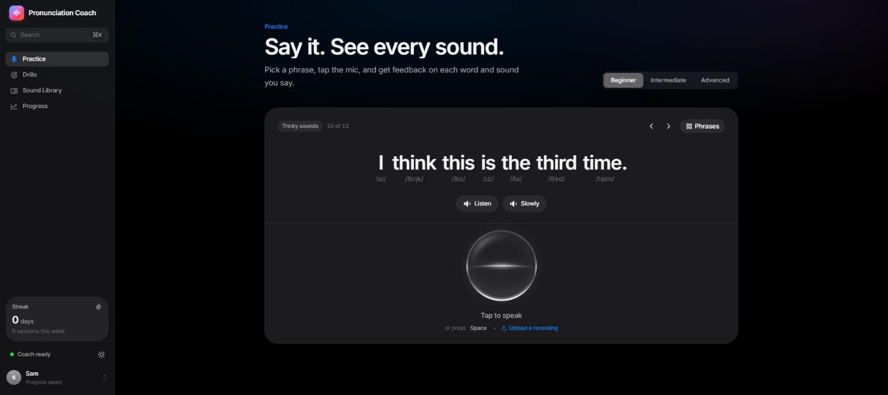

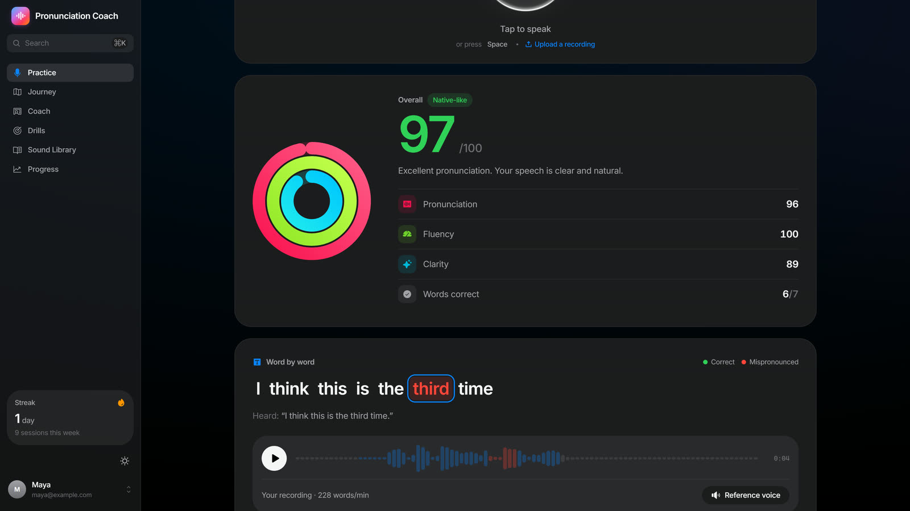

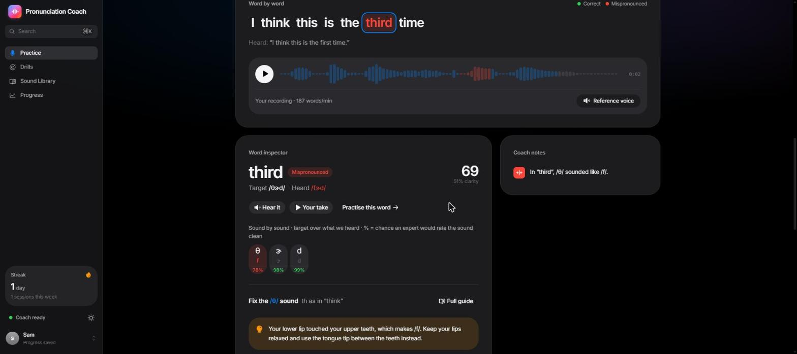

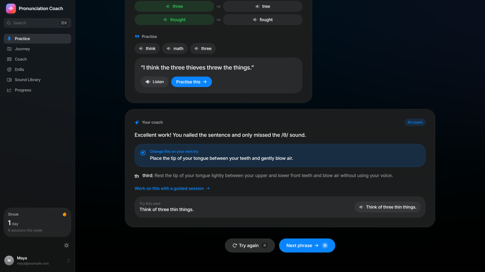

The screenshots are from the running app on a desktop browser (1600 × 900, dark theme), taken in October 2026. The learner is a synthetic voice (Kokoro) saying "I think this is the furd time" against the target "I think this is the third time", so the slip is deliberate; every score, flag and tip is what the app returned for that recording.

## What you get

The practice page offers sentences at three levels, or your own text. Every word shows how it sounds, in plain letters (uh-BOWT) or IPA (your choice in Settings), and you can hear the sentence at normal or slow speed in a neural voice. The orb in the middle is a WebGL shader that follows the real audio: your microphone while you record, the coach's voice or your own playback otherwise.

After you speak, you get four scores (pronunciation, fluency, clarity, completeness) and a transcript where each word is marked correct, unclear, mispronounced, skipped or extra. Tap a word to see it sound by sound, with the chance each sound would be rated clean, and to hear just that segment of your recording. A word shows as *unclear* when the sounds look fine but Whisper heard a different word, and the card says what it heard. Under the transcript, a coach card gives a short summary, one tip per slip and a sentence to try next.

Four more pages: drills built from the sounds you miss most often (you record each minimal pair and the coach checks which word it heard), a library of all 41 American English sounds with articulation steps and minimal pairs, a progress page with streaks, trends and history, and a profile page where you manage your account.

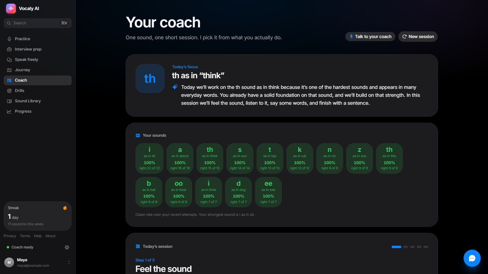

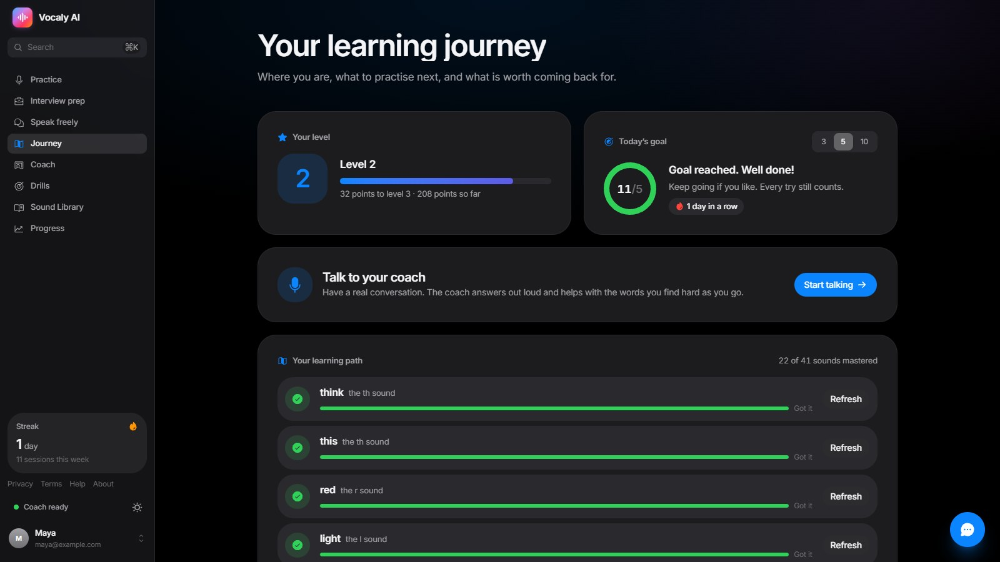

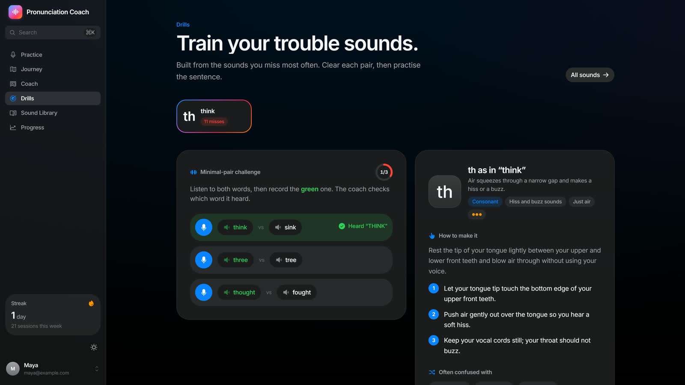

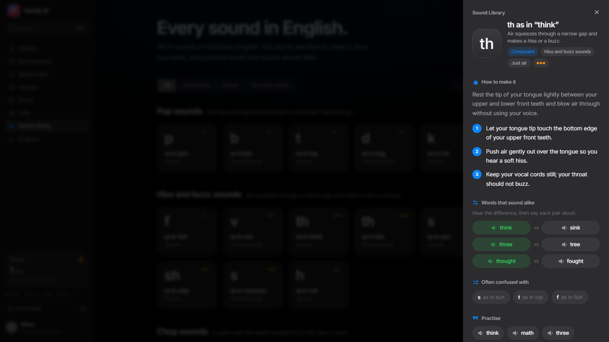

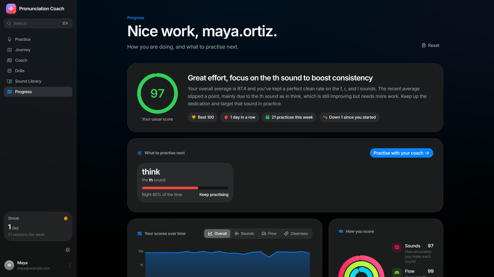

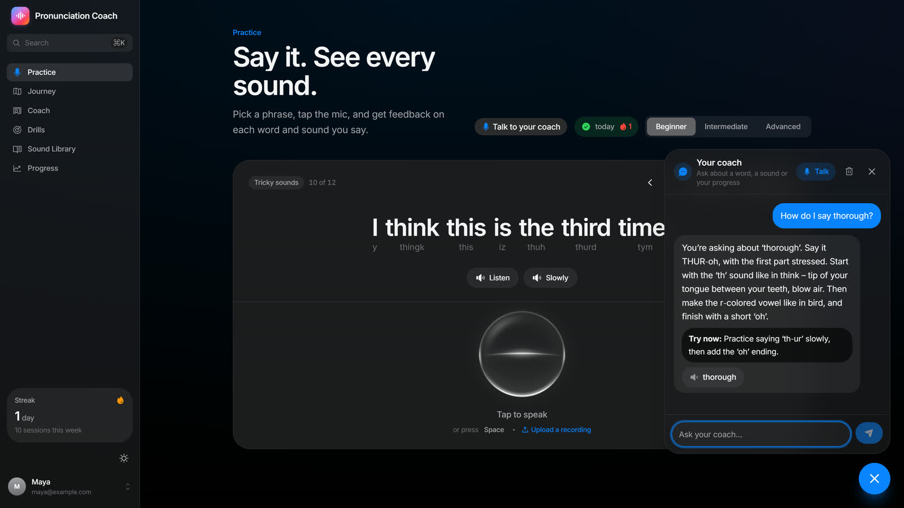

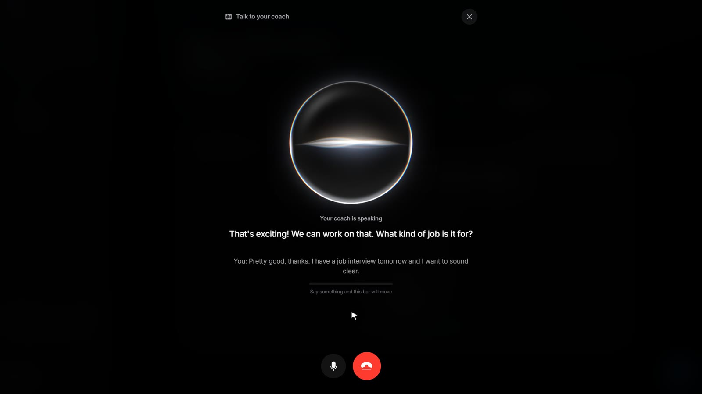

Keyboard: `Space` records, `R` retries, `N` moves to the next phrase, `L` plays the sentence, `Ctrl/⌘ K` opens the command palette. Dark and light themes, a layout for phones, and reduced-motion support.

## How a recording is scored

1. **The browser levels the audio.** Quiet microphones are boosted by up to 24 dB with a soft limiter, then the clip is encoded as 16 kHz mono WAV, so the server rarely needs ffmpeg.
2. **Whisper transcribes it** (faster-whisper, int8) with word timestamps and confidence. Voice activity detection drops silence, which stops Whisper from inventing words on empty clips.
3. **A phoneme model hears the sounds.** wav2vec 2.0 fine-tuned for espeak IPA runs on ONNX Runtime and returns a probability for every sound in every 20 ms frame. It has no language model, so it does not "correct" a wrong sound into the right word the way Whisper tends to.
4. **Goodness of pronunciation per sound.** For each expected sound the scorer computes how likely it is, given everything else in the sentence, against every alternative, including "dropped". The strongest alternative becomes the diagnosis (`/θ/ came out as /s/`). The method is the alignment-free GOP of Cao et al. (Interspeech 2024).
5. **Words are aligned** with a weighted edit distance, so one skipped word does not shift the rest. Numbers are spelled out and homophones count as correct. Each word's score blends what Whisper heard with what the audio sounded like.
6. **The four metrics** are pronunciation (sound accuracy of the words you said), completeness (share of target words you attempted), fluency (speaking rate, long pauses, extra words) and clarity (Whisper's confidence on the target words). The overall score is a weighted blend, capped by completeness and curved by difficulty.

When the phoneme model is not installed, steps 3 and 4 are skipped and scoring uses Whisper's words and CMUDict alone. Everything still works, with less precise sound-level feedback.

### The coaching session

The Coach page (`/coach`, sign-in required) works from what the app has recorded about you. Every sound you attempt is stored as clean or not, so the coach knows your clean-rate per sound and whether it is improving, steady or slipping.

It then picks one sound to work on, weighting how often it goes wrong by how often you try it and giving slipping sounds a boost, and says why in numbers ("you said /θ/ cleanly 3 of 10 times, and it has slipped lately"). The session has five steps: feel the sound (mouth placement), hear minimal pairs, say words (your own most-missed words first), say a sentence, and a review that compares today with your history. Each recording is checked for that one sound only.

After any normal attempt the coach card ends with a single "change this on your next try" cue instead of a list. The focus and every number come from your history; the language model only writes the wording, and a built-in coach does when it is unavailable.

### How well it works

Scoring was checked against expert ratings on [speechocean762](https://huggingface.co/datasets/mispeech/speechocean762) (Apache-2.0): 5,000 English sentences read by Mandarin speakers, rated per sentence, word and sound by trained annotators. The blend weights, sound threshold and fluency curve were fitted on its training split. The figures below are on recordings from the test split that were not used for fitting. Correlations are Pearson's r with the human rating.

| Test split, 500 recordings | Before | Now |
|---|---:|---:|
| Sentence accuracy | 0.514 | **0.651** |
| Sentence overall score | 0.507 | **0.697** |
| Sentence fluency | −0.084 | **0.627** |
| Word accuracy | 0.422 | **0.555** |
| Sound agreement (per sound) | n/a | 0.536 |
| "Was this sound wrong?" (AUC) | n/a | 0.939 |

"Before" is the app as it was: Whisper's words and CMUDict only, with a fluency score that penalised fast speech. On a second set of 300 recordings the same code scores 0.717 sentence accuracy, 0.626 word accuracy and 0.744 fluency; the blend weights were fitted on that second set, so treat those as optimistic.

The fluency rule changed because human raters in this data score *faster* readers as more fluent (word rate correlates at +0.56 with their fluency rating), while the old rule punished anything over 180 words per minute. The audio model also rescues words Whisper drops: when Whisper reports a word as missing but the sounds are there, the word is scored from the sounds instead of getting zero. That one change moved word accuracy from 0.398 to 0.555.

#### What these numbers do not say

The recordings are scripted reading by one first-language group, so they say little about spontaneous speech or other accents. Only about 4% of sounds in the data are rated less than clean, which makes "was this sound wrong" a rare-event problem. At the threshold the app uses, about one flagged sound in three is a real slip, and many slips go unflagged.

The phoneme model also leans toward the sound you were supposed to make. In a separate check I had the Piper voice say twelve deliberate substitutions inside full sentences (θ→s, ð→d, v→b, r→l, ʃ→s and similar). The sound model flagged four of them, and Whisper hearing a different word caught two more, so half were reported as less than clean. When the same sounds are spoken alone the model separates them (it hears `think` and `sink` differently), but inside a familiar phrase it often hears the intended sound: `berry` read as `very` came back clean both times. Synthetic speech is not learner speech, so this is not a recall figure for real users, but it is the main weakness to know about. A model fine-tuned on non-native speech would be the next step.

The scores estimate how a human rater would hear you. They are not a measurement of your accent, and the absolute level is generous: a sentence with one wrong sound in seven words can still score in the nineties.

To reproduce:

```bash
pip install pyarrow scipy
python scripts/export_phoneme_model.py ~/.cache/pronunciation_coach/phonemes
python scripts/eval_speechocean.py prepare   --split test --limit 500
python scripts/eval_speechocean.py report    --split test --limit 500
python scripts/eval_speechocean.py calibrate --split train --limit 700   # after: prepare --split train --no-asr
```

## Talking to the coach

The coach can hold a spoken conversation (`backend/voice_agent.py`, `GET /ws/voice`), powered by Gemini Live:

```
mic --16 kHz PCM--> this server --> Gemini Live --24 kHz PCM--> this server --> speakers
                       |  |
                       |  +-- the abuse check runs on what was said
                       +----- the same audio goes to our own phoneme model; a mispronounced word is
                              passed to the coach, which mentions it kindly
```

- **The key stays on the server.** The browser only ever talks to our own WebSocket; `GEMINI_API_KEY` is read on the server.
- **It hears how you said it, not only what.** After each turn the audio is scored with the same Whisper and phoneme models used for practice. If a word was clearly mispronounced, the coach is told, at most once every 25 seconds, so it can say the word and invite another try. A generic voice assistant cannot do this.
- **Grounded.** The coach is told the learner's level, first language and weak and strong sounds, and is instructed to speak plainly, in one to three short sentences, about everyday topics.
- **Safe.** Abusive speech is caught by `backend/moderation.py` and answered calmly, and the model is told to stay on speaking practice. Asked who made it, the coach says it was developed by Ali Mehdi Khan (the text chat answers that question itself, without calling the model).
- **Limits.** Gemini Live is paid by the second, so every call has a budget:

  | Limit | Default | What the learner sees |
  |---|---|---|
  | Conversations at once (whole server) | 3 | "The coach is on other calls right now" |
  | Conversations at once per caller | 1 | "You already have a conversation open" |
  | New conversations per caller | 8 a minute | "Please wait a minute" |
  | Length of one conversation | 6 minutes | A countdown in the last minute; 30 seconds before the end the coach is told to say goodbye |
  | Talk time per caller per day (UTC) | 20 minutes | The last call is shortened to what is left, then "It resets tomorrow" |
  | Silence | 90 seconds | Halfway through, the coach asks if they are still there; then the call ends |
  | Audio sent | Real time | A client sending audio faster than anyone can speak is disconnected |

  A caller is an IP address, so people sharing one connection (a classroom, an office) share the daily allowance. Counts are kept in memory per process and reset when the server restarts.
- **Models.** `PRONUNCIATION_COACH_VOICE_MODEL` (default `gemini-3.1-flash-live-preview`) is tried first, then `PRONUNCIATION_COACH_VOICE_FALLBACKS` (default `gemini-3.8-live,gemini-2.5-flash-native-audio-latest`). Google renames live models often, so the names are settings.
- **Privacy.** On Google's free tier, audio and text sent to Gemini may be used to improve their products. The talking screen says so before the first conversation, and this app does not store the audio.

Set `GEMINI_API_KEY` to switch it on (`/health` then reports `voice_agent: true`); without it the Talk buttons are hidden.

## The learning journey

A scorer tells you how you did. A coach gives you a route and a reason to come back. The **Journey** page (`backend/journey.py`) turns the attempts the app already stores into that, with no extra tables:

| Part | What it does |
|---|---|
| **Check-up** | Six short sentences that between them cover the sounds learners most often miss. At the end it suggests a level (average under 60 is beginner, under 80 intermediate, otherwise advanced) and the path starts from real data. |
| **Learning path** | The 41 sounds in teaching order (th, r, l, v, w, sh, ch, j, ng ... first). Each unit shows Got it / Practising / Started / Not started, and **Start** opens a coach session on exactly that sound (`/coach?focus=`). |
| **Daily goal** | 3, 5 or 10 attempts a day, chosen in Settings, shown on the practice page as `2/5 today` with the streak. |
| **Level and points** | 10 to 20 points per attempt (a little more for a good score). Level n needs 60 x (n-1)^2 points in total. |
| **Badges** | Twelve milestones (first attempt, 10/50/100 attempts, scores of 80 and 90, 3/7/30-day streaks, first and fifth sound mastered, goal met on five days), with how far away each one is. |
| **Time to review** | Words missed at least twice and at least a quarter of the time, not seen for 12 hours, most missed first. |

`GET /api/journey/{username}` returns all of it in one call, and `GET /api/journey/placement` returns the check-up sentences.

## The coach's notes

The tip text comes from a language model through [Groq](https://groq.com) when `GROQ_API_KEY` is set, and from the built-in knowledge base otherwise. The model only explains slips that the scorer already found. It never sees audio or your name, it cannot change a score, and its answer is validated before it is shown. If the call fails or times out, the knowledge-base tip appears instead. Replies are cached per set of slips, and the endpoint has its own rate limit.

The default model is `openai/gpt-oss-120b` at medium reasoning effort, which answered in about two seconds on Groq's free tier. High effort took about 18 seconds without better tips.

### What else the model does

Beyond explaining one attempt, the model has three larger jobs. They share one rule: the facts come from the learner's own data and the model only words or composes with them, and its answer is checked before anyone sees it. Each falls back to a built-in template when the model is unavailable.

| Feature | Where | What is checked |
|---|---|---|
| **Ask your coach** | Coach page, `POST /api/coach/chat` | Answers are grounded in the learner's sounds and latest attempts. Replies are length-capped, practice words are validated, and the prompt keeps it to pronunciation. No name or email is sent. |
| **Fresh sentences** | Coach page, `POST /api/coach/practice` | Every sentence must fit the level's length and contain at least two words whose dictionary pronunciation has the target sound. The words listed come from our own check, not the model's claim. |
| **Progress note** | Progress page, `GET /api/coach/report/{username}` | Written only from the numbers in the analytics, and cached per set of numbers. |

### How the chat understands a question

The chat is a floating button on every page. Before the model is called, the server works out what is being asked and attaches the right facts:

| The learner asks | What the server adds |
|---|---|
| A word ("mitochondria", "how do I say thorough") | The word, spelling-corrected against the dictionary, with IPA, syllables and stress |
| A sound ("the r sound") | The library's description of how that sound is made |
| "Ship or sheep?" | Both words, their sounds, and the sounds that differ |
| "How am I doing?" | The learner's real numbers: average, improvement, weakest and strongest sounds |
| "Give me sentences with th" | Sentences written by the model and checked against the dictionary |
| Something abusive | A respectful reply from `backend/moderation.py`, with no model call |

The model is asked to talk like a coach sitting next to the learner: short sentences, no IPA unless the learner used it, and words broken into syllables with the stressed one in capitals (my-toh-KON-dree-uh). The practice chips under an answer are the word that was asked about, not whatever the model suggested.

### Across the whole app

The model is not a feature on one screen. Wherever it appears it gets the same context:

- **First language.** In Settings the learner can pick their first language from a fixed list. It is sent with attempt feedback, chat, generated sentences and the progress note so the coach can say what is usually hard for that group ("Hindi speakers often swap v and w"). It stays in the browser and only list values ever reach a prompt.
- **Continuity.** Attempt feedback receives the score of the previous attempt at the same phrase and says how this one compares.
- **On the practice page.** The "For me" button writes one new sentence for the learner's weakest sound at their level, checked against the dictionary.
- **Visibility.** `/health` reports which model is configured, the fallbacks and how many answers each has given. `/metrics` exposes `pc_llm_calls_total{model,outcome}`, `pc_llm_seconds{model}` and `pc_llm_results_total{kind,source}` (what learners were actually shown: model, cached or template), so a rising template share or a run of `http_429` is easy to see.

### Keeping the model reliable

Groq's free tier allows about 8,000 tokens a minute per model, and reasoning models occasionally produce JSON the provider rejects. `CoachService` therefore tries `PRONUNCIATION_COACH_LLM_MODEL` first, then each model in `PRONUNCIATION_COACH_LLM_FALLBACKS` (default `qwen/qwen3.8-27b,openai/gpt-oss-20b`), and retries a rejected JSON reply as plain text. A bad key stops at once. If every model fails the template answer is used.

`scripts/eval_coach.py` runs a fixed set of questions through any model and checks the answers (valid JSON, correct articulation, stays on topic, ignores prompt injection, no invented numbers). On the free tier all three usable models passed the same cases, with median latency 1.7 s (`gpt-oss-120b`), 1.2 s (`gpt-oss-20b`) and 0.4 s (`qwen3.8-27b`).

### Noise cleanup

Recordings go through `backend/enhance.py` before scoring. A spectral filter removes steady room noise when the recording is audibly noisy, and stretches of speech far quieter than the learner (people talking behind them) are turned down. Clean recordings are left untouched. The results screen says when the room was noisy.

It was measured on 60 human-rated utterances from speechocean762 with room noise 8 dB under the speech (`scripts/eval_noise.py`):

| | Sentence accuracy (PCC) | Word accuracy (PCC) |
|---|---|---|
| Noisy, no cleanup | 0.587 | 0.418 |
| Noisy, spectral filter | 0.592 | 0.448 |
| Noisy, RNNoise (neural) | 0.573 | 0.355 |

RNNoise sounds cleaner to a person but lowered accuracy, because it distorts the cues the scoring models use, so it is off by default (`PRONUNCIATION_COACH_NOISE_NEURAL=1` turns it on, with `pyrnnoise` installed). Two limits to know about: a second person talking at the same loudness as the learner cannot be removed by loudness alone, and cleanup is not applied to the audio played back to the learner.

## Architecture

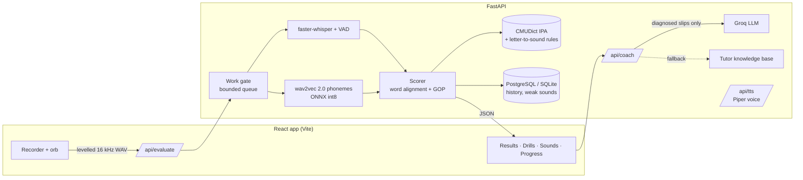

| Layer | Tools |
|---|---|
| Frontend | React 19, TypeScript, Vite, Tailwind CSS v4, shadcn/ui (Radix), Motion, GSAP, Three.js (orb), TanStack Query, Zustand, Recharts |
| Backend | Python 3.11, FastAPI, SQLAlchemy, Prometheus client |
| Speech | faster-whisper (CTranslate2, Silero VAD), wav2vec 2.0 phoneme model on ONNX Runtime, Piper TTS, NLTK CMUDict |
| Coaching | Groq chat API (optional), built-in knowledge base of 41 sounds, 50 substitution tips and 16 deletion tips |
| Data | PostgreSQL (for example Neon) in production, SQLite locally |
| Delivery | Docker multi-stage build, GitHub Actions CI |

## Run it locally

You need Python 3.11+ and Node 20+. ffmpeg is used if it is on your `PATH`; otherwise the bundled `imageio-ffmpeg` binary is used.

```bash
git clone https://github.com/alimehdikhan/A.I-Pronunciation-Coach.git
cd A.I-Pronunciation-Coach

python -m venv .venv
source .venv/bin/activate            # Windows: .venv\Scripts\activate
pip install -r backend/requirements.txt -r backend/requirements-dev.txt

cd frontend && npm ci && cd ..
```

Run the API and the Vite dev server in two terminals, then open http://localhost:5173:

```bash
make dev-api     # python -m uvicorn backend.main:app --reload --port 8000
make dev-web     # cd frontend && npm run dev
```

The first start downloads Whisper (about 140 MB for `base`). The server accepts requests straight away and loads models in the background; speech endpoints return `503` with `Retry-After` until they are ready. `PRONUNCIATION_COACH_LOAD_MODELS_ON_STARTUP=0` skips model loading, which is handy for UI work.

Settings can live in a `.env` file at the project root (it is git-ignored; see `.env.example`). Real environment variables take precedence over it.

### Turning on acoustic scoring

The phoneme model is not bundled with the repository. Download the exported int8 file (355 MB) from the Hub into the cache directory:

```bash
python -c "from huggingface_hub import snapshot_download; snapshot_download('Alimehdi973/wav2vec2-espeak-onnx-int8', local_dir='$HOME/.cache/pronunciation_coach/phonemes')"
```

After a restart, `/health` reports `"acoustic_scoring": true`. On a 4-core CPU a four-second clip takes about one second. To rebuild the file from Meta's original weights instead, run `scripts/export_phoneme_model.py` (it needs PyTorch, `transformers`, `onnx` and `onnxscript`, which the app itself does not).

### Voices

The default voice is Piper. Kokoro sounds more natural and is used automatically when it is installed (`auto`), with Piper as the fallback. On a 4-core CPU the full-precision Kokoro model runs at about 1.2 times real time and about 1.0 times on two threads. The int8 file is smaller but about four times slower on CPUs, so it is not used. Rendered clips are cached in memory and on disk. The Docker build runs `scripts/prerender_voice.py`, so the phrase library, example words and practice sentences are already rendered when the Space starts; only text a learner types is synthesised live (about 4 to 6 seconds on the Space's two cores, then cached).

Learners can pick the coach's voice in Settings: eight Kokoro voices (American and British, female and male) share one loaded model, and a "Quick" Piper voice renders almost instantly. `GET /api/voices` lists them and `/api/tts?voice=` selects one; an unknown id quietly gets the default.

```bash
pip install -r backend/requirements-voice.txt
# download kokoro-v1.0.onnx (325 MB) and voices-v1.0.bin (28 MB) from
# https://github.com/thewh1teagle/kokoro-onnx/releases/tag/model-files-v1.0
# into ~/.cache/pronunciation_coach/kokoro/
```

`/health` reports the active engine as `tts_engine`. Pick another Kokoro voice with `PRONUNCIATION_COACH_KOKORO_VOICE` (`af_heart` by default; `am_michael`, `bf_emma` and others are included).

### Turning on the AI coach

Create a key at console.groq.com and add it to `.env`:

```
GROQ_API_KEY=your-key
```

### Where accounts are stored

Accounts and practice history live in the database named by `NEON_DATABASE_URL`. `DATABASE_URL`, `POSTGRES_URL` and `POSTGRESQL_URL` are accepted too, a pasted `psql '...'` command is cleaned up, and a PostgreSQL URL is always preferred over a SQLite one. Without any of them the app falls back to a SQLite file.

**On a container host (Hugging Face Spaces, Docker, Render) a SQLite file is thrown away on every restart or deploy, which erases every account.** The app warns about this in its log, `/health` reports it as `"database": {"engine": ..., "persistent": ..., "source": <variable name>}`, and the sign-in and profile pages show a notice when it applies. Set a PostgreSQL URL (for example from Neon, which has a free tier) to keep accounts across deploys.

### Production build

```bash
make run         # builds frontend/dist, then FastAPI serves UI and API on :8000
```

FastAPI serves the built app with client-side routing, a Content-Security-Policy derived from the built `index.html`, long-lived caching for fingerprinted assets, `no-cache` for the shell, gzip, and JSON 404s for unknown API routes.

## Deployment

### Docker

```bash
docker build -t pronunciation-coach .
docker run -p 7860:7860 -e NEON_DATABASE_URL="postgresql://…" -e GROQ_API_KEY="…" pronunciation-coach
```

The image builds the frontend in a Node stage, installs the Python dependencies (no PyTorch), bakes in CMUDict, the Whisper weights and the Piper voice for fast cold starts, logs JSON, and runs as a non-root user. The baked Whisper size follows `WHISPER_MODEL_SIZE`; use `--build-arg PRELOAD_WHISPER=none` to skip it.

The phoneme model is downloaded from the Hub during the build as well (`--build-arg PRELOAD_PHONEMES=0` skips it, and `PHONEME_MODEL_REPO` points at another copy). If that download fails the build still succeeds and the app scores from Whisper's words only. Without `NEON_DATABASE_URL`, history is stored in SQLite inside the container and is lost when the container is replaced.

### Hugging Face Spaces

The front matter at the top of this file configures a Docker Space on port 7860. Pushing to the Space remote rebuilds it. Add `NEON_DATABASE_URL` and `GROQ_API_KEY` as secrets. Hugging Face passes Space variables to the build as build args, so `WHISPER_MODEL_SIZE` (and `PRELOAD_PHONEMES=0` to skip the phoneme model) can be set under Settings → Variables.

Free Spaces sleep after 48 hours without traffic. The `Keep Space awake` workflow (`.github/workflows/keep-alive.yml`) pings the Space every 6 hours and waits for it to come back if it was asleep. GitHub pauses scheduled workflows after 60 days without repository activity; re-enable it from the Actions tab if that happens.

### Render

`render.yaml` builds with `build.sh` (Python dependencies plus the frontend build) and starts Uvicorn. Set `NEON_DATABASE_URL` in the dashboard.

## Configuration

All settings are environment variables. See [`.env.example`](.env.example).

| Variable | Default | Description |
|---|---|---|
| `NEON_DATABASE_URL` | `sqlite:///./pronunciation_coach.db` | PostgreSQL URL (for example Neon) or SQLite path |
| `WHISPER_MODEL_SIZE` | `base` | `tiny`, `base`, `small`, `medium`, `large` |
| `PRONUNCIATION_COACH_PHONEME_SCORING` | `1` | `0` ignores the phoneme model even if it is installed |
| `PRONUNCIATION_COACH_PHONEME_DIR` | `~/.cache/pronunciation_coach/phonemes` | Where `phonemes.onnx` and `vocab.json` live |
| `PRONUNCIATION_COACH_PHONEME_THREADS` | `0` | CPU threads for the phoneme model (`0` = all cores) |
| `GROQ_API_KEY` | unset | Enables AI-written coaching tips. Unset uses the built-in tips |
| `PRONUNCIATION_COACH_LLM_MODEL` | `openai/gpt-oss-120b` | Groq chat model for the tips |
| `PRONUNCIATION_COACH_LLM_TIMEOUT` | `8` | Seconds to wait before falling back to built-in tips |
| `PRONUNCIATION_COACH_VOICE_MAX_SESSIONS` | `3` | Voice conversations running at once on the server |
| `PRONUNCIATION_COACH_VOICE_SESSION_SECONDS` | `360` | Longest single voice conversation (at least 60) |
| `PRONUNCIATION_COACH_VOICE_DAILY_MINUTES` | `20` | Voice talk time per caller per UTC day (`0` = no daily allowance) |
| `PRONUNCIATION_COACH_VOICE_IDLE_SECONDS` | `90` | A voice call where the learner says nothing for this long is ended |
| `PRONUNCIATION_LANGUAGE` | `eng-Latn` | Epitran code for the out-of-dictionary fallback |
| `PRONUNCIATION_COACH_LOAD_MODELS_ON_STARTUP` | `1` | `0` skips loading models (UI work, tests) |
| `PRONUNCIATION_COACH_MAX_UPLOAD_BYTES` | `26214400` | Largest accepted upload (25 MB) |
| `PRONUNCIATION_COACH_MAX_AUDIO_SECONDS` | `60` | Longest accepted recording |
| `PRONUNCIATION_COACH_RATE_LIMIT` | `30` | Audio requests per client IP per minute (`0` disables) |
| `PRONUNCIATION_COACH_TTS` | `1` | Neural coach voice at `/api/tts` (`0` falls back to browser speech) |
| `PRONUNCIATION_COACH_TTS_ENGINE` | `auto` | `auto` uses Kokoro when installed, `kokoro` or `piper` force one |
| `PRONUNCIATION_COACH_KOKORO_VOICE` | `af_heart` | Kokoro voice name |
| `PRONUNCIATION_COACH_KOKORO_DIR` | `~/.cache/pronunciation_coach/kokoro` | Where the Kokoro model files live |
| `PRONUNCIATION_COACH_TTS_VOICE` | `en_US-lessac-medium` | Piper voice, downloaded on first start if missing |
| `PRONUNCIATION_COACH_TTS_DIR` | `~/.cache/pronunciation_coach/piper` | Voice cache directory |
| `PRONUNCIATION_COACH_ASR_DEVICE` | `auto` | `cpu`, `cuda` or `auto` |
| `PRONUNCIATION_COACH_ASR_COMPUTE_TYPE` | `auto` | CTranslate2 precision (`int8` on CPU, `float16` on GPU) |
| `PRONUNCIATION_COACH_ASR_BEAM_SIZE` | `5` | Whisper beam size (`1` is a little faster) |
| `PRONUNCIATION_COACH_ASR_THREADS` | `0` | CPU threads per transcription (`0` = all cores) |
| `PRONUNCIATION_COACH_ASR_CONCURRENCY` | `1` | Transcriptions run at once |
| `PRONUNCIATION_COACH_ASR_QUEUE_LIMIT` | `8` | Transcriptions allowed to wait; beyond that, `503` + `Retry-After` |
| `PRONUNCIATION_COACH_ASR_DIR` | `~/.cache/pronunciation_coach/whisper` | Whisper cache directory |
| `PRONUNCIATION_COACH_CORS_ORIGINS` | localhost | Comma-separated allowed origins |
| `PRONUNCIATION_COACH_FRONTEND_DIR` | `frontend/dist` | Location of the built UI |
| `PRONUNCIATION_COACH_FRAME_ANCESTORS` | `'self' https://huggingface.co https://*.hf.space` | Pages allowed to embed the app |
| `PRONUNCIATION_COACH_METRICS` | `1` | Expose Prometheus metrics at `/metrics` |
| `PRONUNCIATION_COACH_METRICS_TOKEN` | unset | If set, `/metrics` requires `Authorization: Bearer <token>` |
| `PRONUNCIATION_COACH_ENABLE_AGENT` | `0` | Enables the development-only `/api/agent/analyze` code scanner |
| `PRONUNCIATION_COACH_LOG_LEVEL` | `INFO` | Log level |
| `PRONUNCIATION_COACH_LOG_FORMAT` | `text` | `json` for structured logs (the Docker image uses `json`) |
| `VITE_API_URL` | same origin | Build-time API origin if the UI is hosted separately |

## API

| Method | Path | Description |
|---|---|---|
| `GET` | `/health` | Liveness, model status, whether acoustic scoring and the AI coach are on |
| `GET` | `/ready` | `200` only when models are loaded and the database is reachable |
| `GET` | `/metrics` | Prometheus metrics: request latency by route, Whisper queue, TTS cache, rate limiting |
| `POST` | `/api/evaluate` | Score a recording (`audio`, `target_text`, optional `difficulty`, `username`) |
| `POST` | `/api/coach` | Tips for an attempt, from the sentence, score and diagnosed slips (JSON) |
| `POST` | `/api/transcribe` | Transcribe with word timings, no scoring |
| `GET` | `/api/tts?text=&rate=` | The coach's voice as WAV (cached), played through Web Audio so the orb follows it |
| `GET` | `/api/pronounce?text=` | IPA, syllables and stress for each word of a sentence |
| `GET` | `/api/phonemes` | All 41 sounds (summary) |
| `GET` | `/api/phonemes/{symbol}` | Full tutor entry for one sound |
| `GET` | `/api/tutor/card?word=&expected=&actual=` | Tutor card for one slip |
| `GET` | `/api/tutor/personalized-practice/{username}` | Drills for a user's weakest sounds |
| `GET` | `/api/history/{username}` | Attempts with sound mistakes; `limit`, `offset`, `min_score`, `max_score`, `q` (phrase) and a `total` |
| `DELETE` | `/api/history/{username}` | Delete a user's history (needs the profile key) |
| `GET` | `/api/analytics/{username}` | Averages, streaks, trend, top weaknesses, improvement, a twelve-week calendar, per-sound mastery and tricky words |
| `GET` | `/api/coach/plan/{username}` | Mastery per sound, today's focus and a guided session |
| `GET` | `/api/journey/{username}` | Level, points, daily goal, badges, the path through the sounds and the words to review |
| `GET` | `/api/journey/placement` | The six check-up sentences |
| `POST` | `/api/coach/chat` | Ask the coach a question (`message`, `history`), grounded in the learner's own data |
| `POST` | `/api/coach/practice` | Fresh practice sentences for a sound (`phoneme`, `level`, `topic`), each verified to contain it |
| `GET` | `/api/coach/report/{username}` | A short written progress note |
| `WS` | `/ws/voice` | A live spoken conversation with the coach (first message `start`, then PCM audio up and down) |
| `GET` | `/api/voices` | The coach voices on offer; `/api/tts?voice=` picks one |
| `POST` | `/api/auth/register` | Create an account (`email`, `password`, `username`, optional `display_name`); upgrades a guest profile in place |
| `POST` | `/api/auth/login` | Sign this browser in to an account |
| `POST` | `/api/auth/logout` | Sign this browser out |
| `GET` | `/api/auth/me` | The account this browser is signed in to, or `{"account": false}` |
| `PATCH` | `/api/auth/me` | Change the username (unique) and/or the display name (may be shared) |
| `POST` | `/api/auth/password` | Change the password (signs out other devices) |
| `POST` | `/api/auth/delete` | Delete the account and its history (needs the password) |

Interactive docs are at `/docs`. Every response carries an `X-Request-ID` (also in the logs), and `/api/evaluate` reports `Server-Timing` for upload, decode, asr, phonemes, score and save.

### Accounts and profiles

First-time visitors land on the sign-in page, which also offers "Practice without signing in". A guest can record and be analysed, but the score, the word-by-word breakdown, the coach's tips and the progress page are shown only to signed-in users. The result is kept in the browser, so signing in or creating an account brings that same recording's score straight back. This is an interface gate rather than an access control: the API still returns a result to any client that asks for it.

**Guests.** There is no sign-up. Each browser keeps a random profile key and sends it as `X-Profile-Key`. The first browser to use a name claims it, and only that key can read, add to or delete its history afterwards. The server stores a SHA-256 hash of the key. If a name is claimed elsewhere, evaluation still returns feedback with `"saved": false, "save_error": "profile_locked"`, and the history endpoints return `403` with `"code": "profile_locked"`.

**Accounts.** `/signup` and `/login` create and open an account. You sign in with your email **or** your username plus your password, and the form says which part is wrong (no such account, or wrong password) and, when signing up, whether the username or email is already used before you submit. An account has two names: a **display name**, which several people can share, and a **username**, which is unique because practice history is stored and looked up under it. Signing up from a guest profile upgrades it in place, so its history is kept. There are no server-side sessions: signing in binds that browser's profile key to the account, so every existing endpoint authorises the same way it does for guests. One account can be open on several devices, and signing out removes only the device you signed out on. Changing the password signs out every other device. `/profile` shows your stats and lets you change both names, change the password, delete your history or delete the account.

Passwords are hashed with scrypt (stdlib, per-password salt) and compared in constant time. Common passwords and passwords containing your username or email are refused, and the auth endpoints have their own stricter rate limit. Telling someone that an account does not exist is a deliberate usability choice: sign-up already reveals which emails and usernames are taken, and the rate limit bounds guessing. There is no email verification and no password reset yet, because the app has no mail service; losing the password means losing access to the account's history.

To release a guest name, for example after clearing browser data, run `python -m backend.manage unlock "<name>"`. `python -m backend.manage users` lists names and whether they are claimed.

## Tests

```bash
make test        # pytest: scorer, phonetics, GOP, coach, security, audio, API (models mocked)
make lint        # ruff
make typecheck   # TypeScript
```

The GOP implementation is checked against brute-force enumeration of CTC paths on small inputs, so the dynamic programming is tested against the definition, not against itself. CI runs backend lint and tests plus the frontend typecheck and production build on every push and pull request.

## Project layout

```
backend/
  main.py             App assembly: middleware, routers, startup, SPA mount
  config.py           Settings from the environment and .env
  api/                Routes: health, speech, library, progress, coach, auth
  runtime.py          Loaded models and the bounded transcription queue
  audio.py            Upload validation, WAV fast path, hardened ffmpeg, loudness
  asr.py              faster-whisper wrapper (VAD, word timestamps)
  phoneme_model.py    wav2vec 2.0 phoneme recogniser on ONNX Runtime
  gop.py              Alignment-free goodness of pronunciation from CTC posteriors
  acoustic.py         Per-word acoustic evidence and the score blend
  pronunciation.py    Scoring: word alignment, metrics, insights
  phonetics.py        Tokenising, CMUDict to IPA, letter-to-sound rules, alignment
  coach.py            Groq tips with validation, cache and template fallback
  teaching.py         Mastery, focus choice and the guided session
  tutor.py            Tutor cards and personalised drills
  phoneme_kb.py       Knowledge base: 41 sounds, substitution and deletion tips
  tts.py              Piper and Kokoro voices with clip caches
  repositories.py     Database queries (SQL aggregates for analytics)
  security.py         Rate limiting, profile keys, password hashing, security headers
  observability.py    Logging, request IDs, Prometheus metrics, Server-Timing
  spa.py              Serving the built app, CSP, legacy-cache recovery
  database.py         Models, indexes, additive migrations, schemas
frontend/src/
  pages/              Practice, Coach, Drills, Sounds, Progress, Profile, Login and Signup
  components/         practice/ (orb, results, inspector, coach), tutor/, layout/, ui/
  hooks/              Recorder, playback, audio peaks, hotkeys
  lib/                API client, queries, speech, audio engine, GSAP helpers
scripts/
  export_phoneme_model.py   One-time ONNX export of the phoneme model
  eval_speechocean.py       Benchmark, calibration and blend fitting
  prerender_voice.py        Fill the Kokoro clip cache for the fixed content
tests/
```

## License

MIT
